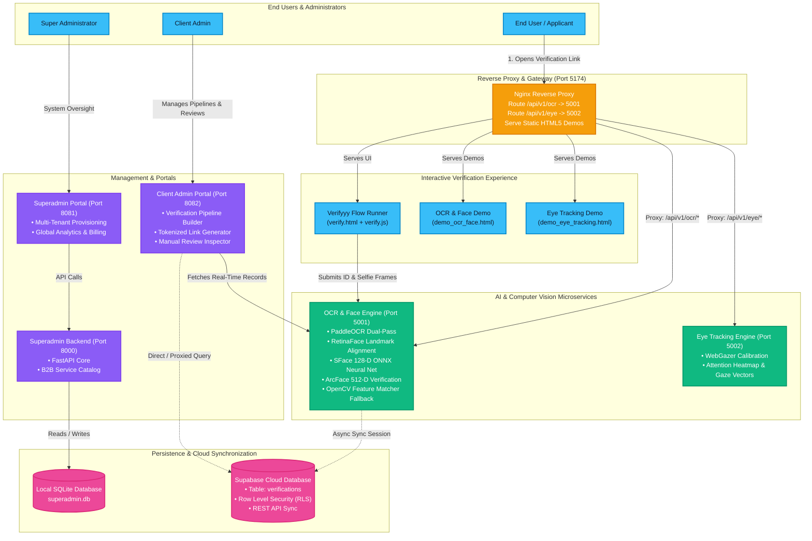
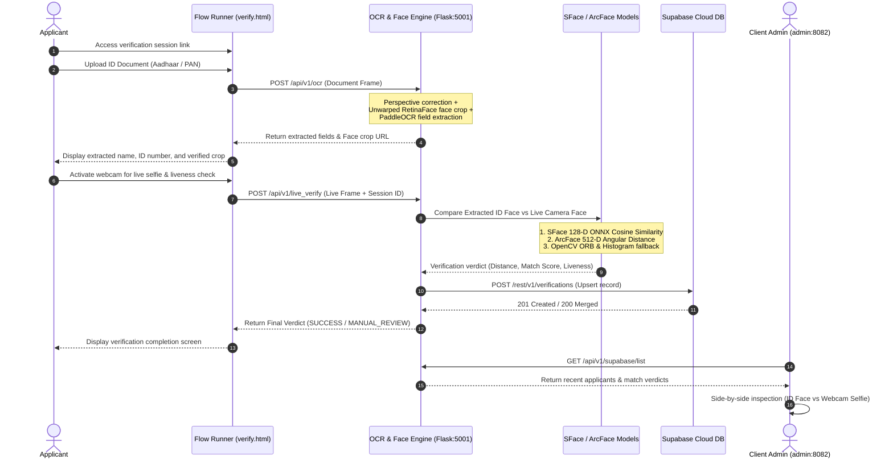

# Verifyyy - Enterprise eKYC & Identity Verification Platform

[](https://python.org)
[](https://fastapi.tiangolo.com)
[](https://flask.palletsprojects.com)
[](https://necolas.github.io/react-native-web/)
[](https://opencv.org)
[](https://supabase.com)
[](https://www.docker.com)

**Verifyyy** is a comprehensive, production-ready Electronic Know Your Customer (**eKYC**) and digital identity verification platform. Built with a modular microservice architecture, it combines state-of-the-art computer vision (PaddleOCR, RetinaFace, SFace ONNX, ArcFace), real-time camera liveness detection, browser-based eye tracking, a no-code verification pipeline builder for enterprise clients, and centralized superadmin governance with cloud database synchronization.

---

## Table of Contents
- [Key Features & Innovations](#key-features--innovations)
- [System Architecture](#system-architecture)
  - [High-Level Architecture Diagram](#high-level-architecture-diagram)
  - [End-to-End Verification Flow](#end-to-end-verification-flow)
- [Repository Structure](#repository-structure)
- [Microservices & Components](#microservices--components)
  - [1. OCR & Face Verification Engine](#1-ocr--face-verification-engine)
  - [2. Verifyyy Interactive Flow Runner](#2-verifyyy-interactive-flow-runner)
  - [3. Client Admin Portal & Pipeline Builder](#3-client-admin-portal--pipeline-builder)
  - [4. Superadmin Management Portal](#4-superadmin-management-portal)
  - [5. Eye Tracking & Liveness Module](#5-eye-tracking--liveness-module)
- [Database & Cloud Sync (Supabase)](#database--cloud-sync-supabase)
- [Getting Started](#getting-started)
  - [Prerequisites](#prerequisites)
  - [Environment Setup](#environment-setup)
  - [Option A: Dockerized Deployment (Recommended)](#option-a-dockerized-deployment-recommended)
  - [Option B: Local Bare-Metal Setup](#option-b-local-bare-metal-setup)
- [Service URLs & Ports](#service-urls--ports)
- [API Reference](#api-reference)
- [Security, Privacy & Safeguards](#security-privacy--safeguards)
- [License](#license)

---

## Key Features & Innovations

### 🪪 Universal Document OCR
- **Automatic Document Classification**: Real-time detection (`detect_document_type`) differentiating between **Aadhaar Cards** (UIDAI 12-digit format), **PAN Cards** (10-character alphanumeric tax IDs), **Driving Licenses**, and **Voter IDs**.
- **Dual-Pass Extraction**: Combines high-resolution perspective rectification, CLAHE illumination normalization, and dual-pass PaddleOCR extraction with algorithmic fuzzy error correction.
- **Robust Field Parsing**: Extracts Name, Date of Birth (DOB), ID Number, and Father's Name with strict validation regex patterns.

### 👤 Multi-Tier Deep Face Recognition
- **Unwarped Face Extraction**: Detects and extracts face crops directly from raw, unwarped source camera frames using RetinaFace 5-point landmark alignment. This eliminates aspect ratio distortion and geometric squashing caused by quadrilateral perspective warping.
- **Tier 1 - SFace 128-D Deep Neural Network (OpenCV ONNX)**: Ultra-fast, lightweight embedded ONNX deep neural network (`cv2.FaceRecognizerSF`) computing 128-dimensional facial embeddings and Cosine distance similarity.
- **Tier 2 - ArcFace (DeepFace)**: 512-dimensional angular margin loss feature projection with adaptive threshold relaxation (0.75) engineered specifically for low-resolution, laminated, or aged government ID photos.
- **Tier 3 - OpenCV Feature Matcher Fallback**: Histogram equalization, normalized 2D correlation, and ORB feature descriptor cross-checking ensuring zero downtime even in compute-constrained offline environments.

### ⚡ Client Admin Portal & Pipeline Builder
- **Visual Drag-and-Drop Pipeline Builder**: Enterprise clients can visually assemble custom eKYC flows (e.g., Aadhaar OCR & Face Match → Eye Tracking Attention Check → Manual Human Review).
- **Shareable Verification Links**: Generates instant, tokenized client-specific links (`/verify.html?pipeline=...`).
- **Live Records Inspector & Human Audit Queue**: Full audit dashboard displaying extracted document faces side-by-side with live captured selfie frames, with one-click Approve / Reject decisions.

### 🌐 Cloud Sync & Hybrid Persistence
- **Supabase Cloud Integration**: Asynchronous, non-blocking synchronization of verification sessions to Supabase with Row Level Security (RLS) policies and B-tree indexing.
- **Offline / Local Fallback**: Seamless local fallback to SQLite and local in-memory storage when cloud credentials are unconfigured or disconnected.

---

## System Architecture

### High-Level Architecture Diagram



---

### End-to-End Verification Flow



---

## Repository Structure

```
identity-verify-mvp/
├── .env.example                     # Sample environment configuration for Supabase
├── .gitignore                       # Clean Git configuration excluding models, uploads, logs
├── docker-compose.yml               # Multi-container orchestration (OCR, Eye, Nginx)
├── README.md                        # Comprehensive system documentation & architecture
├── supabase_schema.sql              # Supabase table DDL, RLS policies, and index statements
│
├── admin/                           # Client Admin Portal
│   └── frontend/                    # React Native Web application
│       ├── App.js                   # Pipeline Builder, Links Manager, Manual Review Inspector
│       ├── index.js                 # Application entrypoint
│       └── package.json             # React Native Web / Expo dependencies
│
├── products/                        # Verification Engines & Frontend Runners
│   ├── demo_ocr_face.html           # Standalone Document OCR & Live Face Match Demo
│   ├── demo_ocr_face.js             # Client logic for demo OCR and Supabase lookup
│   ├── demo_eye_tracking.html       # WebGazer eye tracking & attention calibration demo
│   ├── demo_eye_tracking.js         # Gaze tracking controller
│   ├── demo_audio_liveness.html     # Voice liveness & challenge-response demo
│   ├── demo_audio_liveness.js       # Audio waveform & speech verification logic
│   ├── verify.html                  # Dynamic Verifyyy Flow Runner
│   ├── verify.js                    # Multi-step pipeline execution engine
│   ├── webgazer.js                  # Precompiled WebGazer browser gaze tracking library
│   ├── style.css                    # Shared design system styles (Teal/Slate theme)
│   ├── nginx.conf                   # Reverse proxy configuration
│   │
│   ├── ocr_engine/                  # Flask AI Computer Vision Engine
│   │   ├── engine.py                # Core OCR, SFace, ArcFace, and verification APIs
│   │   ├── download_sface.py        # Automated SFace ONNX model downloader
│   │   ├── sface.onnx               # OpenCV SFace 128-D ONNX model binary
│   │   ├── supabase_client.py       # Resilient Supabase REST client (GET, LIST, UPSERT)
│   │   ├── quality.py               # Blur, glare, illumination, and sharpness checker
│   │   ├── FSRCNN_x2.pb             # Super-resolution model for low-res document crops
│   │   ├── Dockerfile               # Container build for OCR microservice
│   │   └── requirements.txt         # Python dependencies
│   │
│   ├── eye_tracking_module/         # FastAPI Eye Tracking Service
│   │   ├── main.py                  # Gaze vector analytics API
│   │   └── Dockerfile               # Container build
│   │
│   └── ocr_uploads/                 # Ephemeral runtime upload cache (.gitkeep protected)
│
└── superadmin/                      # Platform Superadmin Management System
    ├── backend/                     # FastAPI core backend
    │   ├── main.py                  # Multi-tenant API endpoints & B2B service catalog
    │   ├── database.py              # SQLite / PostgreSQL SQLAlchemy connection
    │   ├── superadmin.db            # Local SQLite database
    │   └── requirements.txt         # FastAPI dependencies
    └── frontend/                    # React Native Web Superadmin Dashboard
        ├── App.js                   # Tenant management & service overview UI
        └── package.json             # Expo dependencies
```

---

## Microservices & Components

### 1. OCR & Face Verification Engine
- **Location**: `products/ocr_engine/`
- **Framework**: Flask (`engine.py`) on port `5001`.
- **Endpoints**:
  - `POST /api/v1/ocr`: Ingests document image. Performs perspective correction, text region segmentation, PaddleOCR extraction, and unwarped face crop extraction.
  - `POST /api/v1/live_verify`: Ingests live webcam frame, performs liveness verification, crops live face, executes SFace / ArcFace cross-comparison against reference face, and synchronizes the session to Supabase.
  - `GET /api/v1/supabase/get/<identifier>`: Fetches verification record by `session_id` or `id_number`.
  - `GET /api/v1/supabase/list`: Returns recent 50 verification records for administrative inspection.

### 2. Verifyyy Interactive Flow Runner
- **Location**: `products/verify.html` + `products/verify.js`
- **Purpose**: Serves as the dynamic runner executed when an end user clicks a generated pipeline link (e.g., `verify.html?pipeline=AADHAAR_FACE,EYE_TRACKING`).
- **Capabilities**:
  - Dynamically builds a step progress indicator.
  - Sequentially steps through document capture, OCR review, live selfie matching, and eye tracking calibration.
  - Displays instant visual pass/fail badges with confidence metrics.

### 3. Client Admin Portal & Pipeline Builder
- **Location**: `admin/frontend/`
- **Framework**: React Native Web / Expo on port `8082`.
- **Capabilities**:
  - **No-Code Pipeline Builder**: Add, remove, and reorder verification modules (Aadhaar OCR, PAN OCR, Face Match, Eye Tracking, Human Review).
  - **Instant Verification Link Generator**: Generates shareable applicant URLs.
  - **Live Audit Table**: Real-time view of all applicants fetched directly from Supabase / OCR engine.
  - **Manual Review Inspector**: Modal interface displaying extracted ID crop side-by-side with webcam selfie for human verification of flagged cases.

### 4. Superadmin Management Portal
- **Location**: `superadmin/`
- **Stack**: FastAPI (`superadmin/backend`) on port `8000` + React Native Web (`superadmin/frontend`) on port `8081`.
- **Capabilities**: Multi-tenant client provisioning, global API usage monitoring, and B2B verification service catalog management.

### 5. Eye Tracking & Liveness Module
- **Location**: `products/eye_tracking_module/`
- **Framework**: FastAPI on port `5002` + browser-side `webgazer.js`.
- **Capabilities**: Real-time eye gaze coordinate calibration (9-point interactive grid), attention heatmap tracking, and active liveness verification.

---

## Database & Cloud Sync (Supabase)

Verifyyy includes native support for [Supabase](https://supabase.com) PostgreSQL database storage.

### 1. Execute SQL Schema
Run the provided SQL script in your Supabase SQL Editor (`supabase_schema.sql`):

```sql
CREATE TABLE IF NOT EXISTS public.verifications (
    id UUID PRIMARY KEY DEFAULT gen_random_uuid(),
    session_id VARCHAR(255) UNIQUE NOT NULL,
    document_type VARCHAR(50),
    id_number VARCHAR(100),
    extracted_name VARCHAR(255),
    dob VARCHAR(50),
    ocr_confidence FLOAT DEFAULT 0.0,
    face_match_verified BOOLEAN DEFAULT FALSE,
    face_match_distance FLOAT,
    face_match_threshold FLOAT,
    liveness_verified BOOLEAN DEFAULT FALSE,
    liveness_score FLOAT DEFAULT 0.0,
    overall_status VARCHAR(50) DEFAULT 'PENDING',
    extracted_face_url TEXT,
    live_holder_face_url TEXT,
    metadata JSONB DEFAULT '{}'::jsonb,
    created_at TIMESTAMPTZ DEFAULT NOW(),
    updated_at TIMESTAMPTZ DEFAULT NOW()
);

ALTER TABLE public.verifications ENABLE ROW LEVEL SECURITY;

CREATE POLICY "Allow public read access" ON public.verifications FOR SELECT USING (true);
CREATE POLICY "Allow public insert access" ON public.verifications FOR INSERT WITH CHECK (true);
CREATE POLICY "Allow public update access" ON public.verifications FOR UPDATE USING (true);

CREATE INDEX IF NOT EXISTS idx_verifications_session_id ON public.verifications(session_id);
CREATE INDEX IF NOT EXISTS idx_verifications_id_number ON public.verifications(id_number);
```

### 2. Configure Environment Variables
Copy `.env.example` to `.env` in the project root:

```bash
cp .env.example .env
```

Edit `.env` with your Supabase credentials:

```ini
SUPABASE_URL=https://your-project-ref.supabase.co
SUPABASE_KEY=your-supabase-anon-or-service-key
SUPABASE_TABLE=verifications
```

> **Note**: If `.env` is omitted or credentials remain as placeholders, the platform automatically operates in **Local Standalone Mode** with zero crashes.

---

## Getting Started

### Prerequisites
- **Git**
- **Python 3.10+**
- **Node.js 18+** & `npm`
- **Docker Desktop** (optional, recommended for production)

---

### Environment Setup

Ensure the SFace ONNX neural model is present in `products/ocr_engine/`:

```bash
python products/ocr_engine/download_sface.py
```

---

### Option A: Dockerized Deployment (Recommended)

To launch the OCR microservice, Eye Tracking engine, and Nginx reverse proxy simultaneously:

```bash
docker compose up --build -d
```

To run the Superadmin Portal:
```bash
# Terminal 1: Superadmin Backend
cd superadmin/backend
pip install -r requirements.txt
uvicorn main:app --reload --port 8000

# Terminal 2: Superadmin Frontend
cd superadmin/frontend
npm install
npm run web -- --port 8081
```

To run the Client Admin Portal:
```bash
# Terminal 3: Client Admin Frontend
cd admin/frontend
npm install
npm run web -- --port 8082
```

---

### Option B: Local Bare-Metal Setup

#### 1. OCR & Face Engine
```bash
cd products/ocr_engine
python -m venv .venv
# Windows:
.venv\Scripts\activate
# Linux/macOS:
# source .venv/bin/activate

pip install -r requirements.txt
python download_sface.py
python engine.py
# Running on http://127.0.0.1:5001
```

#### 2. Eye Tracking Backend
```bash
cd products/eye_tracking_module
pip install fastapi uvicorn
uvicorn main:app --reload --port 5002
```

#### 3. Superadmin Backend & Frontend
```bash
# Backend
cd superadmin/backend
pip install -r requirements.txt
uvicorn main:app --reload --port 8000

# Frontend
cd superadmin/frontend
npm install
npm run web -- --port 8081
```

#### 4. Client Admin Portal
```bash
cd admin/frontend
npm install
npm run web -- --port 8082
```

---

## Service URLs & Ports

| Service | Port / URL | Description |
| :--- | :--- | :--- |
| **Central Nginx Gateway** | [http://localhost:5174](http://localhost:5174) | Reverse proxy routing API calls and serving static demos |
| **Verifyyy Dynamic Flow Runner** | [http://localhost:5174/verify.html](http://localhost:5174/verify.html) | Interactive applicant verification pipeline |
| **OCR & Face Match Demo** | [http://localhost:5174/demo_ocr_face.html](http://localhost:5174/demo_ocr_face.html) | Standalone document OCR & webcam matching UI |
| **Eye Tracking Demo** | [http://localhost:5174/demo_eye_tracking.html](http://localhost:5174/demo_eye_tracking.html) | WebGazer attention tracking demo |
| **OCR AI Microservice** | [http://localhost:5001](http://localhost:5001) | Flask OCR, SFace, ArcFace, and Supabase sync service |
| **Eye Tracking Microservice** | [http://localhost:5002](http://localhost:5002) | FastAPI eye tracking backend |
| **Client Admin Portal** | [http://localhost:8082](http://localhost:8082) | Pipeline builder, link manager, and audit queue |
| **Superadmin Frontend** | [http://localhost:8081](http://localhost:8081) | Platform governance and client provisioning dashboard |
| **Superadmin Backend API** | [http://localhost:8000](http://localhost:8000) | FastAPI B2B services and client database API |

---

## API Reference

### 1. Document OCR & Face Extraction
```http
POST /api/v1/ocr
Content-Type: multipart/form-data
```
**Parameters**:
- `image`: Document image file (JPEG / PNG).
- `doc_type`: (Optional) `aadhaar` | `pan` | `auto`.

**Sample Response**:
```json
{
  "status": "success",
  "session_id": "a8f3b92c",
  "document_type": "aadhaar",
  "extracted_fields": {
    "name": "Jane Doe",
    "dob": "15/08/1995",
    "aadhaar_number": "XXXX XXXX 1234"
  },
  "ocr_confidence": 94.8,
  "face_image_url": "/ocr_uploads/id_face_a8f3b92c.jpg",
  "supabase_sync": {
    "synced": true,
    "status": "success"
  }
}
```

### 2. Live Face Verification & Liveness
```http
POST /api/v1/live_verify
Content-Type: application/json
```
**Payload**:
```json
{
  "image": "data:image/jpeg;base64,...",
  "session_id": "a8f3b92c",
  "step3_faces": ["id_face_a8f3b92c.jpg"]
}
```

**Sample Response**:
```json
{
  "status": "success",
  "session_id": "a8f3b92c",
  "step41_complete": true,
  "face_match": true,
  "step3_face_matches": [
    {
      "step3_face": "id_face_a8f3b92c.jpg",
      "verified": true,
      "distance": 0.284,
      "threshold": 0.670,
      "model": "SFace_Deep_Neural_Network"
    }
  ],
  "overall_status": "SUCCESS",
  "supabase_sync": {
    "synced": true,
    "status": "success"
  }
}
```

### 3. Fetch Verification Record (Supabase Proxy)
```http
GET /api/v1/supabase/get/{session_id_or_id_number}
```

### 4. List Verification Sessions
```http
GET /api/v1/supabase/list
```

---

## Security, Privacy & Safeguards

- **Strict PII Sanitization**: Live test uploads and applicant identity cards are automatically excluded from version control via `.gitignore`.
- **Environment Isolation**: Production credentials (`.env`) are strictly separated from templates (`.env.example`).
- **Row Level Security (RLS)**: Enforces table policies on Supabase, allowing granular permission boundaries for client tenants.
- **Fail-Safe Offline Mode**: If external cloud connections degrade, the verification engine logs an audit notice and completes local verification without blocking applicant throughput.

---

## License

This project is licensed under the [MIT License](LICENSE).
