# Zudoc — Enterprise eKYC, AML & Digital Identity Verification Platform

[](https://python.org)
[](https://fastapi.tiangolo.com)
[](https://flask.palletsprojects.com)
[](https://necolas.github.io/react-native-web/)
[](https://opencv.org)
[](https://onnxruntime.ai/)
[](https://supabase.com)
[](https://www.docker.com)
[](LICENSE)

**Zudoc** is an enterprise-grade, multi-tenant Electronic Know Your Customer (**eKYC**), Anti-Money Laundering (**AML**), and digital identity verification platform powered by the [Zudoc](https://www.zudoc.co/) design system., Anti-Money Laundering (**AML**), and digital identity verification platform. Built with a modular microservice architecture, it combines cutting-edge computer vision (PaddleOCR, RetinaFace 5-point alignment, SFace ONNX 128-D neural network, ArcFace 512-D), real-time camera biometric liveness detection, browser-based eye gaze tracking (WebGazer & FGI-Net), a visual drag-and-drop verification pipeline builder for enterprise clients, dynamic workflow runner, and centralized superadmin governance with hardened Supabase cloud database synchronization and zero-trust security controls.

---

## Table of Contents
- [Executive Overview](#executive-overview)
  - [Core Problems Solved](#core-problems-solved)
- [Key Features & Innovations](#key-features--innovations)
  - [🎨 Zudoc Enterprise Design System & Brand Identity](#-zudoc-enterprise-design-system--brand-identity)
  - [🔗 Connected Pipeline Graph Studio (Zapier & Retool Style)](#-connected-pipeline-graph-studio-zapier--retool-style)
  - [📋 Google Forms-Style Verification Studio & Interactive Flow Canvas](#-google-forms-style-verification-studio--interactive-flow-canvas)
  - [📁 Comprehensive Form Management & Submission Inspector (3-Dots Menu & Manual Review)](#-comprehensive-form-management--submission-inspector-3-dots-menu--manual-review)
  - [⚡ Decoupled AI Architecture: Fast Employee Intake & Admin Local AI Execution](#-decoupled-ai-architecture-fast-employee-intake--admin-local-ai-execution)
  - [🚀 Two-Phase Form Lifecycle (Save ➔ Review ➔ Publish ➔ Share Link)](#-two-phase-form-lifecycle-save--review--publish--share-link)
  - [🪪 Universal Document Classification & Dual-Pass OCR](#-universal-document-classification--dual-pass-ocr)
  - [👤 Three-Tier Cascaded Deep Face Recognition](#-three-tier-cascaded-deep-face-recognition)
  - [👁️ Biometric Liveness & Attention Tracking](#️-biometric-liveness--attention-tracking)
  - [⚡ Visual Drag-and-Drop Pipeline Canvas & Dynamic Stepper](#-visual-drag-and-drop-pipeline-canvas--dynamic-stepper)
  - [🏢 Enterprise Client Admin Portal & Authentication](#-enterprise-client-admin-portal--authentication)
  - [👑 Centralized Superadmin Governance](#-centralized-superadmin-governance)
  - [🌐 Cloud Persistence & Dual-Mode Token Revocation](#-cloud-persistence--dual-mode-token-revocation)
  - [☁️ Direct Supabase Cloud Database Synchronization](#️-direct-supabase-cloud-database-synchronization)
  - [🛡️ Automated Data Retention & Asset Purging](#️-automated-data-retention--asset-purging)
- [System Architecture & Visual Diagrams](#system-architecture--visual-diagrams)
  - [1. High-Level Architecture Diagram](#1-high-level-architecture-diagram)
  - [2. End-to-End Verification Sequence](#2-end-to-end-verification-sequence)
  - [3. Dynamic Pipeline Builder & Runner Flow](#3-dynamic-pipeline-builder--runner-flow)
  - [4. Multi-Tier AI Face Match & Fallback Decision Logic](#4-multi-tier-ai-face-match--fallback-decision-logic)
  - [5. Multi-Modal Liveness & Anti-Spoofing Architecture](#5-multi-modal-liveness--anti-spoofing-architecture)
  - [6. Supabase Entity-Relationship & Cloud Sync Architecture](#6-supabase-entity-relationship--cloud-sync-architecture)
- [Repository Structure](#repository-structure)
- [Microservices & Subsystems](#microservices--subsystems)
- [Security & Cryptographic Architecture (Phase 1 Remediation)](#security--cryptographic-architecture-phase-1-remediation)
  - [1. Fail-Fast Startup Secret & Production Guards](#1-fail-fast-startup-secret--production-guards)
  - [2. Cryptographically Bound Applicant Session Tokens](#2-cryptographically-bound-applicant-session-tokens)
  - [3. Tenant-Scoped HMAC Signed Asset URLs](#3-tenant-scoped-hmac-signed-asset-urls)
  - [4. Dual-Mode Token Revocation Engine](#4-dual-mode-token-revocation-engine)
  - [5. PII Masking & Data Sanitization](#5-pii-masking--data-sanitization)
  - [6. Multi-Tenant Isolation & Row-Level Security](#6-multi-tenant-isolation--row-level-security)
- [Vercel & Cloud Deployment](#vercel--cloud-deployment)
- [Port & Service Routing Matrix](#port--service-routing-matrix)
- [Database & Cloud Sync (Supabase)](#database--cloud-sync-supabase)
  - [1. Database Schema DDL & Hardened RLS Migrations](#1-database-schema-ddl--hardened-rls-migrations)
  - [2. Verification Records & Multi-Tenancy](#2-verification-records--multi-tenancy)
- [Environment Configuration & Secrets](#environment-configuration--secrets)
  - [1. Generate Cryptographically Secure Secrets](#1-generate-cryptographically-secure-secrets)
  - [2. Environment Files Setup](#2-environment-files-setup)
- [Quick Start & Execution Guide](#quick-start--execution-guide)
  - [Option A: Local Bare-Metal Setup (Multi-Terminal)](#option-a-local-bare-metal-setup-multi-terminal)
  - [Option B: Containerized Deployment (Docker Compose)](#option-b-containerized-deployment-docker-compose)
  - [Health Check & Service Verification](#health-check--service-verification)
- [Verification Flow Runner & Dynamic Pipelines](#verification-flow-runner--dynamic-pipelines)
  - [Visual Canvas Usage](#visual-canvas-usage)
  - [Dynamic URL Structure](#dynamic-url-structure)
  - [Supported Flow Modules](#supported-flow-modules)
  - [Example Launch Links](#example-launch-links)
- [Comprehensive API Reference](#comprehensive-api-reference)
  - [1. Issue Applicant Session Token](#1-issue-applicant-session-token)
  - [2. Document OCR & Face Extraction](#2-document-ocr--face-extraction)
  - [3. Live Face Verification & Liveness](#3-live-face-verification--liveness)
  - [4. Generate Signed Asset URL](#4-generate-signed-asset-url)
  - [5. Serve Signed Asset (Protected)](#5-serve-signed-asset-protected)
  - [6. Fetch Verification Record (IDOR Protected)](#6-fetch-verification-record-idor-protected)
  - [7. Administrative Data Retention Purge](#7-administrative-data-retention-purge)
  - [8. Revoke Applicant Session Token](#8-revoke-applicant-session-token)
  - [9. Service Health Check](#9-service-health-check)
- [Testing & Quality Assurance Suite](#testing--quality-assurance-suite)
  - [Running Unit Tests](#running-unit-tests)
  - [Test Suite Breakdown (100 Passing Unit Tests)](#test-suite-breakdown-100-passing-unit-tests)
  - [Running Integration Tests](#running-integration-tests)
- [Troubleshooting & Common Questions](#troubleshooting--common-questions)
- [License & Compliance](#license--compliance)

---

## Executive Overview

Modern digital enterprises (fintechs, neobanks, crypto exchanges, gig economy marketplaces, and healthcare platforms) require fast, accurate, and fraud-resistant identity onboarding. Traditional KYC verification stacks suffer from severe fragmentation, vulnerability to digital spoofing (deepfakes, screen replay, printed photos), rigid one-size-fits-all onboarding pipelines, insecure asset storage leaking sensitive PII, and steep operational costs.

**Verifyyy** delivers a unified, self-hosted, cloud-synchronized eKYC infrastructure that executes universal document extraction, deep biometric face matching, multi-modal active liveness detection, and zero-trust access control across isolated multi-tenant environments.

### Core Problems Solved

1. **Document Fraud & Low Quality Scans:** High rejection rates from blur, glare, and improper orientation are eliminated through automated Laplacian variance filtering, perspective rectification, and dual-pass OCR (PaddleOCR + EasyOCR + Google Cloud Vision fallback).
2. **Biometric Spoofing & Presentation Attacks:** Deepfakes, silicone masks, and screen replays are blocked via a three-tier biometric defense: eye blink EAR tracking, head pose angular trajectory estimation, 9-point WebGazer gaze calibration, and dynamic randomized oral/audio challenges.
3. **Inflexible Onboarding Workflows:** Clients customize verification requirements per product tier using an interactive, visual drag-and-drop pipeline canvas that immediately compiles into parameterized, cryptographically bound verification links (`?pipeline=aadhaar,pan,facematch...`).
4. **IDOR & Multi-Tenant Data Leakage:** Legacy verification systems often expose raw facial images or document scans via predictable URLs. Verifyyy protects all media through ephemeral HMAC-SHA256 signed URLs bound to tenant IDs and expiration timestamps.
5. **Regulatory Compliance (UIDAI, GDPR & DPDP):** First 8 digits of Indian Aadhaar numbers are masked automatically (`XXXX-XXXX-1234`), sensitive PII is sanitized from server logs, and automated cron/API retention purging removes expired physical crops from disk.

---

## Key Features & Innovations

### 🎨 Zudoc Enterprise Design System & Brand Identity
- **Official Zudoc Brand Identity:** Designed to match the official [Zudoc website](https://www.zudoc.co/), unifying the Admin Dashboard, Pipeline Studio, and applicant verification journeys.
- **Typography Stack:** High-end typography featuring **Rival Sans** for brand lockups and primary headings coupled with **Manrope** for crisp, highly readable dashboard and data interfaces.
- **Modern Palette:** Deep signature teal (`#008080`), dark slate neutrals (`#0F172A`), cool canvas surfaces (`#F8FAFC`), crisp white cards (`#FFFFFF`), and refined borders (`#E2E8F0`).
- **Responsive Navigation Segment:** Top app bar featuring breadcrumbs, live environment indicators (`🟢 Live Production`), active flow counters, and one-click quick actions.

### 🔗 Connected Pipeline Graph Studio (Zapier & Retool Style)
- **Centered Flow Canvas (`maxWidth: 840`):** Replaces cluttered sidebars with a spacious, centered workflow canvas connected by sleek vertical pipeline stems (`│`).
- **Pre-Populated Demo Flow:** New forms instantly open with realistic, ready-to-edit demo steps (`Full Legal Name`, `Work Email Address`, and `Aadhaar & Face Verification`) so admins never face an intimidating blank screen.
- **Direct 1-Click Action Dock:** Prominently positioned directly under the flow canvas:
  - **`➕ Add Question`**: 1-click instantly appends a new question card right below.
  - **`🛡️ + Add Verification Module ▾`**: 1-click quick-select for Aadhaar eKYC, PAN Verification, Biometric Liveness, or Manual Review.
  - **`📑 + Page Break`**: 1-click inserts a multi-page section break with stepper navigation.
- **In-Line Between-Step Quick Inserters:** Compact inserter bars (`+ Question` • `🛡️ + Module` • `📄 + Break`) between steps allow inserting elements anywhere in the sequence without opening modal dialogs.
- **Pure React Native Web Custom Controls:**
  - **Custom iOS-Style Switches:** Replaced raw browser checkboxes with animated toggle switches for "Required for applicant".
  - **Horizontal Type Pills:** Instant 1-click switching between Short Answer, Paragraph, Multiple Choice, Checkboxes, Dropdown, Date, and File Upload.
  - **Dynamic Inline Option Editor:** Add, modify, or remove options inline with immediate preview.
  - **Card Drag-and-Drop:** Smooth drag grip (`⠿`) reordering with active drop zone indicators and zero arrow-button friction.
  - **Quick Actions:** In-line Duplicate (`📋 Copy`) and Delete (`🗑️ Delete`) per card.

### 📋 Google Forms-Style Verification Studio & Interactive Flow Canvas
- **Minimalist Studio Hub:** Clean, focused interface inspired by Google Forms. Displays strictly the **Blank form** (`+`) creator card under *"Start a new form"* and previously created pipelines under *"Recent forms"*, stripping out unnecessary clutter.
- **Any-Order Customizability:** Questions, identity verification modules, and page breaks can be interleaved in **any custom sequence on the same page or across multiple pages**. No longer restricted to rigid "form first, then pipeline" structures — admins can ask 2 questions, insert a PAN & Face verification module, ask 2 more questions, add an Aadhaar verification module, insert page breaks, etc.
- **Clean, True Blank Form:** Creating a new form or clicking **Blank form** starts completely fresh (1 single Untitled Question, 0 modules, 1 page) without hardcoded or unwanted preset questions or verification modules.
- **Intuitive Notion-Style Inserters:** Hovering between cards smoothly reveals contextual quick-insert buttons (`+ Question here`, `🛡️ + Verification here`, `📄 + Page Break here`) along with active card quick-action buttons, eliminating repetitive inline clutter.
- **Interactive Question Creator:** Build rich custom application forms with full field customization:
  - **Supported Field Types:** Short answer (`📝`), Paragraph (`📄`), Multiple choice (`🔘`), Checkboxes (`☑️`), Dropdown (`▾`), Date (`📅`), and Document / File Upload (`📁`).
  - **Dynamic Options Editor:** Add, modify, or remove options in real time.
  - **Question Controls:** Individual Required switches, Duplicate (`📄`), and Delete (`🗑️`) controls per card.
  - **Quick Preset Chips:** One-click shortcuts for standard onboarding questions: `+ Full Name`, `+ Work Email`, `+ Phone`, `+ ID Number`, and `+ Document Upload`.
- **Multi-Device Responsiveness:** Fully responsive across mobile, tablet, and desktop displays with sticky builder controls, minimum 16px touch-friendly inputs, adaptive card wrapping, and drag-and-drop handles.
- **Live Form Preview:** Modal preview to inspect and test the applicant's exact questionnaire experience before deploying.

### 📁 Comprehensive Form Management & Submission Inspector (3-Dots Menu & Manual Review)
- **Contextual 3-Dots Action Menu on Recent Forms:**
  - Clicking the three vertical dots (`⋮`) on any form card in the Recent Forms grid or list surfaces:
    - **📁 Manage Form:** Opens the dedicated per-form management dashboard.
    - **⚖️ Manual Review:** Deep-links directly to the compliance audit queue filtered for this form's submissions.
    - **🚀 Open / Test Form:** Immediately launches the candidate verification flow in a new browser tab.
    - **📋 Copy Link:** Copies the cryptographically bound candidate link to the clipboard.
    - **✏️ Edit in Builder:** Re-opens the form and pipeline canvas in the interactive editor.
    - **🗑️ Delete Form:** Safely removes the form and its metadata.
- **Per-Link Candidate Submissions Table:**
  - Automatically isolates and displays submissions received specifically through that form's unique `pipelineId` (`FLOW-XXXXXX`).
  - Lists candidate name/email, session ID, document type, submission date, and overall verification result badge (`✓ APPROVED`, `⚖️ NEEDS REVIEW`, `❌ REJECTED`).
  - Clear empty state guiding administrators to copy and share the link when no submissions have arrived yet.
- **📊 Export Submissions to Sheets (CSV / Excel / Google Sheets):**
  - Download all candidate submissions and form responses for any particular form as a formatted spreadsheet with one click.
  - **Dynamic Column Mapping:** Automatically maps all custom questions as distinct columns alongside standardized identity verification fields:
    - Candidate Identifier & Session ID
    - Submission Date & Time
    - Overall Verification Status (`APPROVED`, `NEEDS_REVIEW`, `REJECTED`)
    - Document Type & Extracted ID / Document Number
    - OCR Extracted Name & Date of Birth
    - Biometric Face Match Verdict, Similarity Confidence Score, and Liveness Check
    - Dynamic Question Responses (every custom form question answered by the applicant)
    - Document & Selfie Photo attachment status
  - **Universal Spreadsheet Compatibility:** Generated with UTF-8 Byte Order Mark (`\uFEFF`) and RFC 4180 escaping so the downloaded file opens seamlessly in **Google Sheets**, **Microsoft Excel**, **Apple Numbers**, and **LibreOffice Calc** without character corruption.
  - **Multiple Export Touchpoints:** Available via the **"📊 Download as Sheets"** button inside the *Manage Form* dashboard, the **"📊 Download as Sheets (CSV)"** option in the Recent Forms 3-dots menu, the **"Sheets 📊"** button in List view, and the **"Export Sheets 📥"** button in *Manage Links*.
- **Integrated Submission Inspector & Manual Review Modal:**
  - **Form Questions & Answers:** Displays all custom question responses submitted by the employee (e.g., Full Legal Name, Work Email, Employee ID).
  - **Side-by-Side Photo Previews:** Full-resolution preview of attached ID document photo and live webcam selfie.
  - **"⚡ Run Local AI Verification (OCR & Face Match)":** Runs PaddleOCR document parsing and ArcFace 512-D facial biometric match on demand via the local engine (`http://localhost:5001`).
  - **Real-Time AI Output Cards:**
    - Document OCR details (ID number, Name on ID, Date of Birth).
    - Biometric match confidence percentage (e.g., `96% Match`), verification verdict, and liveness check.
  - **1-Click Audit Decision:** Administrators can approve or reject the submission instantly, updating the database and dashboard metrics in real time.
- **Pure OCR vs Combined Biometric Module Flexibility:**
  - Pure OCR modules (`PAN`, `AADHAAR`) allow document upload without requiring live selfies, while combined modules (`PAN_FACE`, `AADHAAR_FACE`) require both document and live selfie.
- **Localhost & LAN Network Auto-Detection:**
  - Links generated from the admin portal default directly to `http://localhost:5174` or LAN IP `http://192.168.1.x:5174` so links work immediately across local PCs, laptops, and mobile devices on the same Wi-Fi without reliance on fragile external tunnels.

### ⚡ Decoupled AI Architecture: Fast Employee Intake & Admin Local AI Execution
- **Zero Model Overhead on Applicant Flow:**
  - Heavy AI model loading (OCR & ArcFace) is decoupled from the employee client.
  - **Instant Document Attachment:** Selecting or capturing an Aadhaar or PAN photo immediately renders a high-res thumbnail preview (`✓ Document Attached`) using client-side Data URLs without executing heavy OCR or showing technical errors to employees.
  - **Instant Live Selfie Capture:** Clicking **"📸 Capture Selfie Photo"** captures the frame from the webcam canvas immediately (`✓ Live Selfie Photo Captured`) without running heavy ArcFace models in the applicant's browser or showing biometric match scores.
  - **Instant Gaze Activity:** Eye tracking calibration activity completes in 1 second.
  - **Swift Multi-Page Navigation:** Modules mark status `✓ COMPLETED` instantly so employees can swiftly move to the next page or submit the form.
  - **Polite Confirmation Screen:** Employees see a clean, friendly confirmation (`🎉 Submission Received! Thank you for participating.`) without technical scorecards, error codes, or debug JSON.
  - **Reliable Data Ingestion:** Form responses, document photos, and live selfies are securely ingested into Supabase and cached in local storage.
- **On-Demand Admin Local AI Verification:**
  - Employee submissions arrive directly in the **Manual Review Queue** (`Review & Run AI ⚡`).
  - **Submission Inspector Modal:**
    - Displays all submitted employee form answers (Name, Email, etc.).
    - Displays attached document photo and live webcam selfie photo side-by-side.
    - **"⚡ Run Local AI Verification (OCR & Face Match)"**: Executes PaddleOCR and ArcFace locally on the admin machine on demand (port 5001).
    - **Instant AI Output Display:** Extracted ID number, name, DOB, ArcFace match confidence score (e.g., `96%`), and liveness status.
    - **1-Click Decision:** Admin can approve or reject the applicant with a single click, immediately updating Supabase and live dashboard metrics.

### 🚀 Two-Phase Form Lifecycle (Save ➔ Review ➔ Publish ➔ Share Link)
- **Phase 1: Form Save & Draft Management:** Clicking *"Save Form 💾"* validates and saves the form schema and verification pipeline to the cloud and marks the record as `🟡 Draft (Saved)`. An inspection dialog presents a configuration breakdown (total custom fields, attached modules, and pipeline ID) with options to keep as draft or proceed.
- **Phase 2: Publish & Live Link Sharing:** Clicking *"🚀 Publish Form Now"* promotes the pipeline to `🟢 Published & Live` in the database. The system generates a clean, cryptographically bound shareable URL containing an HMAC applicant session token:
  ```
  http://localhost:5174/verify.html?flow=FORM,AADHAAR_FACE,PAN_FACE&pid=FLOW-XXXXXX&applicant_token=eyJhbGciOiJI...
  ```
  Or for local network (mobile/tablet on same Wi-Fi) or domain sharing:
  ```
  http://192.168.1.13:5174/verify.html?flow=FORM,AADHAAR_FACE,PAN_FACE&pid=FLOW-XXXXXX&applicant_token=eyJhbGciOiJI...
  https://verify.yourdomain.com/verify.html?flow=FORM,AADHAAR_FACE,PAN_FACE&pid=FLOW-XXXXXX&applicant_token=eyJhbGciOiJI...
  ```
- **One-Click Share Actions:** Direct *"📋 Copy Share Link"* with instant visual feedback and *"Open Flow 🚀"* to launch the applicant flow in a new browser tab.
- **Status Badges:** All saved forms on the dashboard show dynamic status indicators (`🟢 Live` vs `🟡 Draft`), allowing administrators to republish, unpublish, or edit pipelines on demand.

### 🪪 Universal Document Classification & Dual-Pass OCR
- **Supported Identity Documents:** Indian Aadhaar (Front/Back/e-Aadhaar), Permanent Account Number (PAN) Card, Voter ID, Driver's License, and International Passports.
- **Image Quality Pre-Flight Guard:** Fast Laplacian variance blur filter (rejects images with blur variance `< 100.0`) and high-specular glare detection to ensure OCR readability before pipeline processing.
- **Perspective Rectification:** Automated contour quadrilateral detection and four-point perspective warp transformation to correct skewed mobile camera snaps.
- **Dual-Pass OCR Engine:** Primary high-accuracy PaddleOCR pass with secondary EasyOCR / Google Vision fallback.
- **UIDAI Aadhaar Masking:** Automatic detection and masking of the first 8 digits of Aadhaar numbers (`XXXX-XXXX-1234`) for UIDAI compliance.
- **Unwarped Facial Crop Extraction:** High-accuracy 5-point facial landmark alignment via RetinaFace/MTCNN, extracting normalized $112 \times 112$ or $128 \times 128$ face crops ready for 1:1 biometric comparison.

### 👤 Three-Tier Cascaded Deep Face Recognition
Verifyyy uses a cascaded three-tier facial comparison architecture that pairs state-of-the-art deep neural networks with zero-dependency classical computer vision fallbacks:

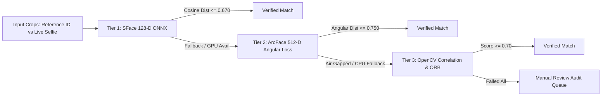

1. **Tier 1 (Primary):** SFace ONNX 128-dimensional deep neural network embedding extractor with Cosine Distance matching (Acceptance Threshold: $\le 0.670$).
2. **Tier 2 (Secondary):** ArcFace (Additive Angular Margin Loss) generating 512-dimensional embeddings for complex lighting or age progression (Acceptance Threshold: $\le 0.750$).
3. **Tier 3 (Zero-Dependency Fallback):** Normalized 2D Cross-Correlation with ORB feature keypoint descriptor matching, ensuring uninterrupted verification even in air-gapped or minimal CPU environments.

### 👁️ Biometric Liveness & Attention Tracking
- **Passive Liveness:** Eye Aspect Ratio (EAR) blink detection, micro-texture frequency analysis, and 3D head pose estimation (yaw, pitch, roll angles).
- **Active Gaze Calibration:** WebGazer 9-point in-browser gaze tracking coupled with FGI-Net neural gaze vector estimation. The applicant follows randomized quadrant visual targets (Top, Bottom, Left, Right) to defeat pre-recorded video replays.
- **Audio/Voice Challenge:** Dynamic randomized oral challenge phrase generation with WebAudio frequency spectrum analysis to confirm active presence.

### ⚡ Visual Drag-and-Drop Pipeline Canvas & Dynamic Stepper
- **Hand-Gesture Drag-and-Drop Reordering:** Enterprise admins customize verification journeys inside a modern canvas. Modules can be dynamically dragged, reordered, or removed with real-time visual drop indicators, live step renumbering (1, 2, 3...), and grabbing gesture feedback.
- **Dynamic Modular Stepper:** Verification links encode the configured pipeline into URL parameters (`?pipeline=pan,aadhaar,pan_face,eye_tracking`). The standalone Verification Flow Runner (`verify.html` / `verify.js`) reads the query string and dynamically orchestrates the exact sequence of steps without requiring server-side code changes.

### 🏢 Enterprise Client Admin Portal & Authentication
- **Dual Authentication Modes:**
  - Standard Work Email & Password Sign In and Sign Up.
  - Passwordless 8-Digit Email OTP Sign In with auto-advancing digit inputs and one-click clipboard paste (`[📋 Paste Code]`).
  - Google OAuth 2.0 Single Sign-On (SSO).
- **Email Verification Confirmation:** Automatic redirect handling (`emailRedirectTo: window.location.origin`) and built-in resend countdown timer to handle mail delivery delays or rate limits gracefully.
- **Audit Center & Side-by-Side Review:** Live verification audit table with side-by-side modal displaying the reference document face crop and the live camera selfie with calculated similarity scores and one-click manual approval/rejection.

### 👑 Centralized Superadmin Governance
- **Multi-Tenant Administration:** Create, configure, suspend, or terminate client tenant organizations.
- **B2B Verification Services Catalog:** Enable, disable, or rate-limit individual capabilities (Aadhaar OCR, PAN OCR, Biometric Face Match, Eye Tracking) per client.
- **Security & Revocation Controls:** Monitor active sessions, inspect audit trails, and instantly revoke compromised applicant tokens across all nodes.

### 🌐 Cloud Persistence & Dual-Mode Token Revocation
- **Supabase PostgreSQL Cloud DB:** Multi-tenant database schema equipped with Row-Level Security (RLS) policies, foreign key tenant boundaries, and composite unique constraints (`(tenant_id, session_id)`).
- **Dual-Mode Token Revocation Engine:** In-memory LRU cache for ultra-fast local checking with automated fallback to Supabase cloud persistence for distributed multi-instance clusters.

### ☁️ Direct Supabase Cloud Database Synchronization
- **End-to-End Form & Pipeline Persistence:** Every form created in the Admin Dashboard is persisted directly to Supabase (`public.verifications` table with `document_type = 'FORM_PIPELINE'`). Metadata includes question arrays, validation rules, attached verification modules, and publish state.
- **Applicant Form Delivery from Cloud:** When an applicant visits a verification link from any device or network, the runner (`verify.html` / `verify.js`) fetches the latest published questionnaire schema directly from the Supabase REST API.
- **Bi-Directional Submission Recording:** Upon completion, applicant responses, OCR-extracted fields, and biometric similarity scores are recorded in real-time in Supabase.
- **Cloud-Synced Manual Review Queue:** Low-confidence or flagged submissions automatically populate the admin review queue. Reviewer decisions (`APPROVED` / `REJECTED`) update Supabase records instantly.
- **Real-Time Dashboard Telemetry:** Pipeline counts, published link metrics, and completed verification stats are calculated live from Supabase PostgreSQL tables.

### 🛡️ Automated Data Retention & Asset Purging
- **GDPR & DPDP Compliance:** Configurable data retention policies (default: 30 days) to prevent perpetual PII storage.
- **Automated Retention Purging:** Physical document crops, live selfies, and debug crops are purged automatically via scheduled background workers (`cleanup_assets.py`) or administrative API trigger (`/api/v1/admin/purge_expired_assets`).

---

## System Architecture & Visual Diagrams

### 1. High-Level Architecture Diagram


<details>
<summary>Click to view Mermaid Architecture Source</summary>

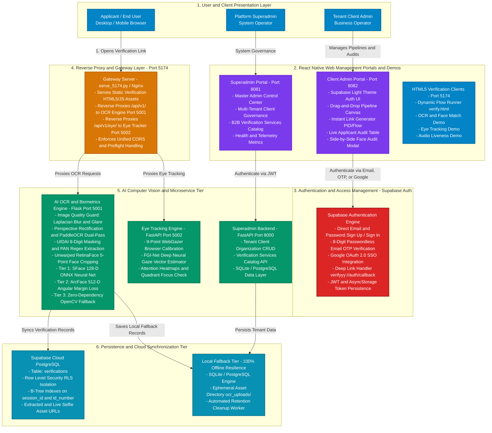
</details>

---

### 2. End-to-End Verification Sequence

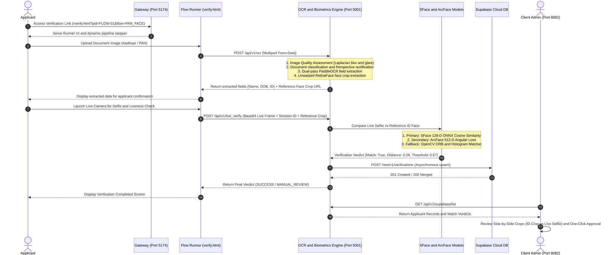

<details>
<summary>Click to view Mermaid Sequence Source</summary>

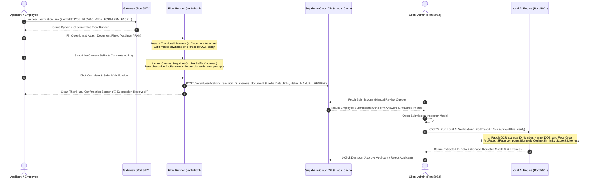
</details>

---

### 3. Dynamic Pipeline Builder & Runner Flow


<details>
<summary>Click to view Mermaid Flowchart Source</summary>

```mermaid
graph LR
    classDef builder fill:#4338ca,stroke:#3730a3,stroke-width:2px,color:#ffffff
    classDef link fill:#0284c7,stroke:#0369a1,stroke-width:2px,color:#ffffff
    classDef runner fill:#059669,stroke:#047857,stroke-width:2px,color:#ffffff
    classDef decision fill:#d97706,stroke:#b45309,stroke-width:2px,color:#ffffff

    subgraph BuilderStep ["1. Pipeline Construction (Admin Portal)"]
        Modules["Available Modules:<br/>- Aadhaar Verification<br/>- PAN Verification<br/>- Aadhaar + Face<br/>- PAN + Face<br/>- Eye Tracking<br/>- Human Review"]:::builder
        Canvas["Visual Drag and Drop Canvas<br/>Pure HTML5 Gesture Reordering<br/>Order: PAN -> Aadhaar -> Face Match"]:::builder
        Modules --> Canvas
    end

    subgraph LinkStep ["2. Parameterized Token Generation"]
        Generator["Generate Link Engine<br/>Creates Unique Pipeline ID PID"]:::link
        ShareURL["Shareable Applicant URL:<br/>/verify.html?pid=FLOW-9182&pipeline=pan,aadhaar,pan_face"]:::link
        Canvas --> Generator --> ShareURL
    end

    subgraph ExecutionStep ["3. Dynamic Client Execution"]
        Parser["Flow Runner URL Parser<br/>Extracts active sequence"]:::runner
        Stepper["Dynamic Stepper Builder<br/>Renders Step 1..N with live indicators"]:::runner
        ShareURL --> Parser --> Stepper
    end

    subgraph VerdictStep ["4. Consolidated Verdict"]
        Audit["Unified Verification Record<br/>Status: PASSED / FLAGGED_FOR_AUDIT"]:::decision
        Stepper --> Audit
    end
```
</details>

---

### 4. Multi-Tier AI Face Match & Fallback Decision Logic


<details>
<summary>Click to view Mermaid Decision Tree Source</summary>

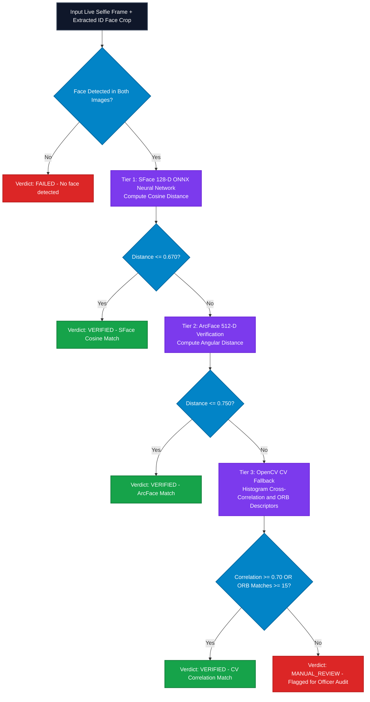
</details>

---

### 5. Multi-Modal Liveness & Anti-Spoofing Architecture


<details>
<summary>Click to view Mermaid Liveness Architecture Source</summary>

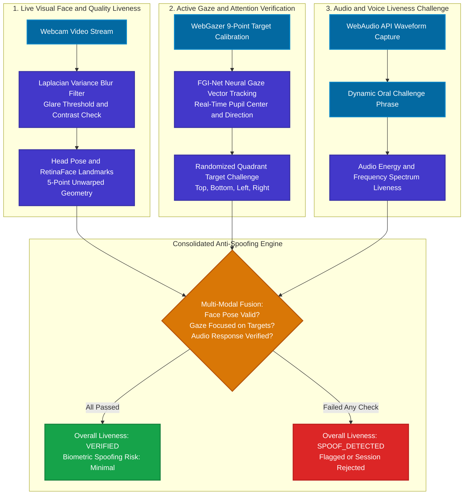
</details>

---

### 6. Supabase Entity-Relationship & Cloud Sync Architecture


<details>
<summary>Click to view Mermaid ER Diagram Source</summary>

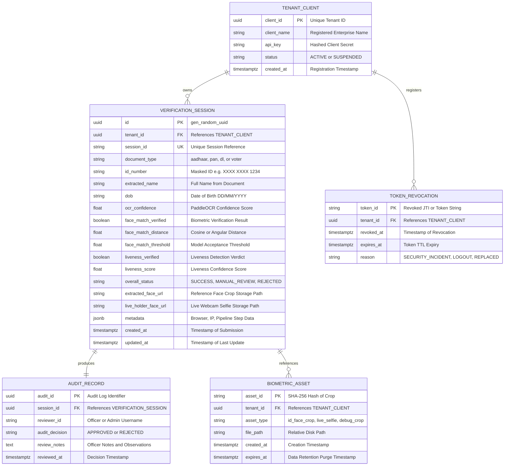
</details>

---

## Repository Structure

```
identity-verify-mvp/
├── README.md                                # Definitive Architecture & Operational Guide
├── index.html                               # Root Navigation Hub & Service Portal
├── start_all.bat                            # One-Click Windows Launcher for All 4 Microservices
├── start_all.sh                             # One-Click Linux/macOS Launcher for All 4 Microservices
├── docker-compose.yml                       # Multi-Container Production Compose Manifest
├── supabase_schema.sql                      # Supabase Table DDL, RLS Policies & Indexes
├── vercel.json                              # Static Gateway Deployment Rewrites
├── pytest.ini                               # Automated Security Test Configuration
├── .env.example                             # Environment Template for Cloud Credentials
├── .gitignore                               # Clean Git Configuration
├── .dockerignore                            # Container Build Exclusions
│
├── admin/                                   # Client Admin Portal Subsystem
│   └── frontend/                            # React Native Web Client Management Portal (Port 8082)
│       ├── .env.example                     # Client Admin Environment Template
│       ├── App.js                           # Google Forms Studio, Pipeline Builder & Live Audit
│       ├── SignInScreen.js                  # Dual-Mode Auth (Password + 8-Digit Email OTP + Google)
│       ├── package.json                     # Frontend Dependencies (Expo 52, React Native Web 0.21)
│       ├── README.md                        # Admin Portal Documentation & Setup Guide
│       ├── lib/
│       │   └── supabase.js                  # Shared Supabase Client & Session Provider
│       ├── scripts/
│       │   └── check-env.js                 # Pre-Build Environment Validator Guard
│       └── src/services/
│           ├── auth.js                      # Supabase Auth Service (Signup redirect & OTP fallback)
│           └── googleAuth.js                # Google OAuth SSO Authentication Helper
│
├── docs/                                    # System Documentation, Visual Assets & Reports
│   ├── README.md                            # Documentation Overview & Asset Index
│   ├── diagrams/                            # High-Resolution SVG System Architecture Diagrams
│   │   ├── architecture_diagram.svg         # High-Level System Architecture Diagram
│   │   ├── diagram_2_sequence.svg           # End-to-End Verification Sequence Diagram
│   │   ├── diagram_3_pipeline_builder.svg   # Dynamic Pipeline Builder & Runner Flow
│   │   ├── diagram_4_face_match_decision.svg# Multi-Tier Face Match Decision Logic
│   │   ├── diagram_5_liveness_antispoof.svg # Multi-Modal Liveness & Anti-Spoofing Architecture
│   │   └── diagram_6_supabase_er.svg        # Supabase ER & Cloud Sync Schema
│   └── reports/                             # Formal Security & Compliance Audit Reports
│       ├── Verifyyy_Security_Architecture_and_Remediation_Report.docx # Security Audit Report
│       └── generate_security_report_docx.py # Automated Report Generator Script
│
├── migrations/                              # Database Schema DDL & Hardened RLS Migrations
│   ├── README.md                            # Database Migration Index & Instructions
│   ├── 20261024_000001_harden_rls_and_multi_tenancy.sql
│   ├── 20261025_000002_revocation_table_and_orphan_strategy.sql
│   └── 20261026_000003_composite_unique_tenant_session.sql
│
├── products/                                # Verification Gateway & Runner Subsystem (Port 5174)
│   ├── README.md                            # Products Gateway & Client Applications Guide
│   ├── index.html                           # Landing Page & Service Navigation Hub
│   ├── serve_5174.py                        # Python Gateway Server (Static Server + Reverse Proxy)
│   ├── nginx.conf                           # High-Performance Nginx Gateway Configuration
│   ├── verify.html                          # Parameterized Verification Flow Runner (Dynamic Stepper)
│   ├── verify.js                            # Modular Stepper Engine & Multi-Modal Orchestrator
│   ├── style.css                            # Verification Flow Responsive UI Theme
│   ├── signin.html / .js / .css             # Standalone Client Portal Authentication Interface
│   ├── demo_ocr_face.html / .js             # Standalone OCR & Face Verification Demo
│   ├── demo_eye_tracking.html / .js         # Standalone WebGazer Eye Tracking Demo
│   ├── demo_audio_liveness.html / .js       # Standalone Voice / Audio Liveness Demo
│   ├── webgazer.js                          # WebGazer In-Browser 9-Point Gaze Calibration
│   ├── ocr_uploads/                         # Ephemeral Runtime Storage Cache (.gitkeep)
│   │
│   ├── eye_tracking_module/                 # Gaze Analysis & Calibration Backend (Port 5002)
│   │   ├── README.md                        # Eye Tracking Module Documentation
│   │   ├── main.py                          # FastAPI Gaze Estimation & Quadrant Tracking Service
│   │   ├── requirements.txt                 # Eye Tracking Dependencies
│   │   └── Dockerfile                       # Container Definition for Gaze Service
│   │
│   └── ocr_engine/                          # AI OCR, Face Engine & Security Backend (Port 5001)
│       ├── README.md                        # AI OCR Engine Documentation & Architecture
│       ├── .env.example                     # Backend Security Environment Template
│       ├── engine.py                        # Core Flask Microservice & Verification Endpoints
│       ├── auth_validator.py                # Security & Cryptographic Validation Layer
│       ├── retention.py                     # Data Retention & File Purging Policies
│       ├── cleanup_assets.py                # Standalone Cron Retention Cleanup Script
│       ├── supabase_client.py               # Supabase PostgreSQL Integration & RLS Sync
│       ├── download_sface.py                # Automated Neural Model Downloader
│       ├── quality.py                       # Image Quality Assessment (Laplacian Blur & Glare)
│       ├── sface.onnx                       # SFace 128-D Deep Neural Net (Cosine Distance)
│       ├── FSRCNN_x2.pb                     # Super-Resolution Neural Net for Blurry Crops
│       ├── requirements.txt                 # Python Dependencies (OpenCV, PaddleOCR)
│       └── Dockerfile                       # Container Definition for AI OCR Engine
│
├── superadmin/                              # Superadmin Platform Subsystem
│   ├── backend/                             # Master Platform Governance API (Port 8000)
│   │   ├── README.md                        # Superadmin Backend Documentation & API Guide
│   │   ├── .env.example                     # Superadmin Backend Environment Template
│   │   ├── main.py                          # FastAPI Superadmin Management Server
│   │   ├── auth_validator.py                # JWT Bearer Authentication & Role Enforcement
│   │   ├── database.py                      # SQLAlchemy Models & SQLite / Postgres Connection
│   │   └── requirements.txt                 # FastAPI & Pydantic Dependencies
│   │
│   └── frontend/                            # Superadmin Control Center UI (Port 8081)
│       ├── README.md                        # Superadmin Frontend Documentation
│       ├── .env.example                     # Superadmin Frontend Environment Template
│       ├── App.js                           # React Native Web Master Governance Console
│       ├── SignInScreen.js                  # Master Control Login (Email/Pass, OTP, Google SSO)
│       ├── AccessRestrictedScreen.js        # Unauthorized Access Warning Interface
│       ├── package.json                     # Dependencies (Expo 52, React Native Web 0.21)
│       ├── lib/
│       │   └── supabase.js                  # Shared Supabase Client & Session Provider
│       ├── scripts/
│       │   └── check-env.js                 # Pre-Build Environment Validator Guard
│       └── src/services/
│           ├── accessControl.js             # Role Validation & Access Control Service
│           ├── auth.js                      # Superadmin Auth Service
│           └── googleAuth.js                # Google OAuth SSO Helper
│
└── tests/                                   # Comprehensive Security & Functional Test Suite
    ├── README.md                            # Test Execution Guide & Matrix
    └── test_security_controls.py            # Automated Security & Cryptographic Unit Tests
```

---

## Microservices & Subsystems

### 1. Products Gateway Server (Port 5174)
- **Primary Roles:** Serves static verification clients (`verify.html`, `demo_*.html`), reverse-proxies `/api/v1/` requests to the AI OCR Engine (port 5001), proxies `/api/v1/eye/` to the Eye Tracker (port 5002), and enforces unified CORS policies across development and production environments.
- **Implementations:** `products/serve_5174.py` (Python HTTP gateway for local development) and `products/nginx.conf` (production-grade reverse proxy).

### 2. AI OCR & Biometrics Engine (Port 5001)
- **Primary Roles:** Executes document classification, perspective rectification, dual-pass OCR, UIDAI 8-digit masking, unwarped RetinaFace face crop extraction, three-tier face comparison (SFace 128-D ONNX, ArcFace 512-D, OpenCV CV correlation), passive liveness verification, and cryptographic asset signing.
- **Implementation:** `products/ocr_engine/engine.py` (Flask microservice).

### 3. Interactive Verification Flow Runner (`verify.html` / `verify.js`)
- **Primary Roles:** Modular, multi-step HTML5 applicant onboarding interface. Reads URL parameters (`?flow=FORM,AADHAAR_FACE,PAN&pid=FLOW-XXXXXX`), fetches custom questionnaire definitions directly from Supabase, dynamically renders progress stepper indicators, coordinates webcam capture, guides applicants through document uploads, and submits payloads to the backend with applicant session tokens.
- **Form Execution:** When `FORM` is specified in the flow, dynamically renders custom questionnaire fields (short answers, paragraphs, multiple choice, checkboxes, dropdowns, dates, file uploads) before seamlessly advancing the applicant to subsequent identity verification stages.
- **Cloud Submission:** Saves applicant responses and completion results directly to the Supabase database.

### 4. Client Admin Portal (Port 8082)
- **Primary Roles:** Enterprise client management console and verification studio.
  - **Google Forms-Style Studio:** Uncluttered dashboard with a single *"Blank form"* (`+`) creation card and *"Recent forms"* gallery.
  - **Interactive Question Builder:** Visual form builder with rich question types (short answer, paragraph, multiple choice, checkboxes, dropdown, date, file upload), question duplicate/delete, and required toggles.
  - **Pipeline Attachment:** Attach biometric and automated modules (Aadhaar OCR, PAN OCR, Face Match, Eye Tracking, Human Review) below custom form fields.
  - **Form Lifecycle & Live Sharing:** Two-phase Save ➔ Review for Publish ➔ Publish workflow generating clean, sanitized applicant links.
  - **Supabase Cloud Sync:** Real-time persistence for all forms, pipeline definitions, applicant runs, review decisions, and dashboard telemetry.
  - **Manual Review Queue:** Side-by-side inspection of reference document face crops vs. live selfie captures with one-click approval/rejection persisted to Supabase.
- **Authentication:** Dual-mode sign-in: Work Email & Password or Passwordless 8-Digit Email OTP with auto-advancing inputs, one-click clipboard paste (`[📋 Paste Code]`), and Google OAuth 2.0 SSO.
- **Implementation:** `admin/frontend/App.js` & `SignInScreen.js` (React Native Web / Expo 52).

### 5. Superadmin Management Platform (Ports 8081 & 8000)
- **Primary Roles:** Multi-tenant platform governance. Allows platform operators to provision new client tenants, configure API keys, toggle B2B verification services (OCR, Biometrics, Eye Tracking), inspect system telemetry, and revoke compromised tokens.
- **Implementations:** `superadmin/frontend/App.js` (React Native Web UI on port 8081) and `superadmin/backend/main.py` (FastAPI server on port 8000).

### 6. Eye Tracking & Attention Analysis Module (Port 5002)
- **Primary Roles:** Advanced anti-spoofing engine utilizing WebGazer 9-point in-browser gaze calibration and FGI-Net deep gaze estimation to verify applicant focus on randomized screen quadrants.
- **Implementation:** `products/eye_tracking_module/app.py` (FastAPI microservice).

---

## Security & Cryptographic Architecture (Phase 1 Remediation)

The platform enforces a zero-trust security architecture designed to prevent unauthorized access, IDOR vulnerabilities, token forgery, and sensitive PII exposure.

```
┌────────────────────────────────────────────────────────────────────────┐
│               ZERO-TRUST SECURITY ARCHITECTURE (PHASE 1)               │
├────────────────────────────┬───────────────────────────────────────────┤
│ Security Layer             │ Mechanism / Implementation                │
├────────────────────────────┼───────────────────────────────────────────┤
│ 1. Startup Secret Guards   │ Fail-fast check on hex secrets (>=32 hex) │
│ 2. Applicant Session Tokens│ HMAC-SHA256, 1h TTL, tenant & module bound│
│ 3. Signed Asset URLs       │ HMAC-SHA256, exp timestamp, tenant-scoped │
│ 4. Token Revocation Engine │ In-Memory LRU + Supabase Cloud DB fallback│
│ 5. PII Masking             │ Aadhaar 8-digit masking, log sanitization │
│ 6. Multi-Tenant Isolation  │ Supabase RLS, composite unique constraints│
│ 7. Automated Data Retention│ Ephemeral crops, automated 30-day purge   │
└────────────────────────────┴───────────────────────────────────────────┘
```

### 1. Fail-Fast Startup Secret & Production Guards
- **Minimum Secret Length:** Core secrets (`APPLICANT_SESSION_SECRET` and `ASSET_SIGNING_SECRET`) must be at least 32 hexadecimal characters (16+ raw bytes).
- **Reject Weak Secrets:** Weak defaults (`default_secret`, `secret`, `changeme`, `123456`) trigger an immediate, fatal `RuntimeError` at boot time, preventing services from operating in an insecure state.
- **Production Guard:** In `APP_ENV=production`, server startup fails immediately if wildcards (`*`) or `localhost` origins are present in CORS configurations, or if mandatory cloud secrets are omitted.

### 2. Cryptographically Bound Applicant Session Tokens
- **Algorithm:** Cryptographically signed compact tokens using HMAC-SHA256:
  $$\text{token} = \text{base64url}(\text{payload}) \,\|\, \text{hex}(\text{HMAC-SHA256}(\text{payload}, K_{\text{session}}))$$
- **Enforced Claims:**
  - `tenant_id`: Strictly isolates verification sessions to the originating client organization.
  - `session_id`: Unique identifier for the individual applicant journey.
  - `modules`: Authorized verification steps (e.g., `["pan", "aadhaar", "pan_face"]`). Unauthorized endpoints reject the token with HTTP 403.
  - `exp`: Maximum 1-hour expiration timestamp. Expired tokens are rejected with HTTP 401.
  - `iat`: Issuance timestamp for freshness validation.

### 3. Tenant-Scoped HMAC Signed Asset URLs
- **IDOR Elimination:** Direct file paths (e.g., `/ocr_uploads/extracted_face_123.jpg`) are strictly non-routable. All media assets must be accessed via signed URLs:
  ```
  /api/v1/assets/serve?path=ocr_uploads%2Fcrop_123.jpg&tenant_id=<UUID>&expires=<TIMESTAMP>&sig=<HMAC_SHA256>
  ```
- **Signature Computation:**
  $$\text{sig} = \text{hex}(\text{HMAC-SHA256}(K_{\text{asset}}, \text{tenant\_id} \,\|\, \text{path} \,\|\, \text{expires}))$$
- **Cross-Tenant Attack Mitigation:** If a tenant attempts to sign or access an asset path belonging to another tenant, the request is rejected with HTTP 403 Forbidden.

### 4. Dual-Mode Token Revocation Engine
- **In-Memory Cache (Local Mode):** High-speed, zero-dependency in-memory LRU set with automatic TTL expiration for single-node deployments.
- **Supabase Cloud Sync (Cluster Mode):** Tokens revoked via the Admin or Superadmin portals are persisted to the `token_revocations` table in Supabase. Distributed engine instances query this table, ensuring instant revocation propagation across clusters.

### 5. PII Masking & Data Sanitization
- **UIDAI Masking:** Extracted Aadhaar numbers are masked to leave only the last 4 digits visible: `XXXX XXXX 1234`.
- **Log Redaction:** All sensitive PII (PAN numbers, Aadhaar numbers, unmasked names, base64 image strings, session secrets) are sanitized via `mask_pii_for_logging` before writing to `stdout` or log files.

### 6. Multi-Tenant Isolation & Row-Level Security
- **Database Boundary:** Supabase tables (`verifications`, `tenants`, `token_revocations`) enforce PostgreSQL Row-Level Security (RLS) policies. Tenants can only query or mutate rows matching their authenticated `tenant_id`.
- **Composite Unique Constraint:** Composite uniqueness on `(tenant_id, session_id)` prevents ID spoofing or cross-tenant session collisions.

---

## Port & Service Routing Matrix

| Port | Service Component | Technology Stack | Local URL | Public Tunnel URL | Key Endpoints / Responsibility |
|:---:|:---|:---|:---|:---|:---|
| **5001** | AI OCR & Face Biometrics Engine | Python / Flask / PyTorch / ONNX | `http://localhost:5001` | — | `/api/v1/ocr`, `/api/v1/live_verify`, `/api/v1/assets/serve`, `/api/v1/auth/applicant_session` |
| **5002** | Eye Tracking & Gaze Service | Python / FastAPI / WebGazer | `http://localhost:5002` | — | `/api/v1/eye/calibrate`, `/api/v1/eye/estimate`, `/api/v1/eye/attention_score` |
| **5174** | Products Gateway & Flow Runner | Python HTTP Server / Nginx | `http://localhost:5174` | `https://shaggy-bees-lay.loca.lt` | Reverse proxy for `/api/v1/`, serves `verify.html`, `demo_*.html`, static JS/CSS |
| **8000** | Superadmin Backend API | Python / FastAPI / Pydantic | `http://localhost:8000` | — | `/api/v1/admin/tenants`, `/api/v1/admin/services`, `/api/v1/admin/metrics` |
| **8081** | Superadmin Management Portal | Expo 52 / React Native Web | `http://localhost:8081` | — | Master platform control console for multi-tenant governance |
| **8082** | Client Admin Portal | Expo 52 / React Native Web | `http://localhost:8082` | `https://nice-papers-check.loca.lt` | Pipeline Builder Canvas, Link Generator, Audit Verification Center |

---

## Database & Cloud Sync (Supabase)

### 1. Database Schema DDL & Hardened RLS Migrations
Database migrations are maintained in `migrations/` and should be executed in the Supabase SQL Editor:

#### Migration 1: RLS & Multi-Tenancy (`20261024_000001_harden_rls_and_multi_tenancy.sql`)
```sql
-- Create tenants organization table
CREATE TABLE IF NOT EXISTS public.tenants (
    id UUID PRIMARY KEY DEFAULT gen_random_uuid(),
    name TEXT NOT NULL,
    api_key_hash TEXT NOT NULL,
    status TEXT NOT NULL DEFAULT 'ACTIVE',
    created_at TIMESTAMPTZ NOT NULL DEFAULT timezone('utc'::text, now())
);

-- Enable RLS on verifications
ALTER TABLE public.verifications ENABLE ROW LEVEL SECURITY;

-- Tenant isolation policy
CREATE POLICY "Tenant isolation for verifications"
ON public.verifications
FOR ALL
USING (tenant_id = auth.uid()::uuid OR tenant_id = (current_setting('app.current_tenant_id', true))::uuid);
```

#### Migration 2: Token Revocations (`20261025_000002_revocation_table_and_orphan_strategy.sql`)
```sql
-- Revocation store for blacklisted applicant tokens
CREATE TABLE IF NOT EXISTS public.token_revocations (
    token_id TEXT PRIMARY KEY,
    tenant_id UUID REFERENCES public.tenants(id) ON DELETE CASCADE,
    revoked_at TIMESTAMPTZ NOT NULL DEFAULT timezone('utc'::text, now()),
    expires_at TIMESTAMPTZ NOT NULL,
    reason TEXT DEFAULT 'SECURITY_INCIDENT'
);

CREATE INDEX IF NOT EXISTS idx_token_revocations_expires ON public.token_revocations(expires_at);
```

#### Migration 3: Composite Uniqueness (`20261026_000003_composite_unique_tenant_session.sql`)
```sql
-- Enforce composite uniqueness to prevent cross-tenant session hijacking
ALTER TABLE public.verifications 
ADD CONSTRAINT uq_tenant_session UNIQUE (tenant_id, session_id);
```

---

## Environment Configuration & Secrets

### 1. Generate Cryptographically Secure Secrets
Generate minimum 32-byte (64-character hexadecimal) cryptographic keys using Python:

```bash
python -c "import secrets; print('APPLICANT_SESSION_SECRET=' + secrets.token_hex(32)); print('ASSET_SIGNING_SECRET=' + secrets.token_hex(32))"
```

### 2. Environment Files Setup

#### A. AI OCR Engine (`products/ocr_engine/.env`)
```env
APP_ENV=development
PORT=5001

# Cryptographic Secrets (Required — min 32 hex chars)
APPLICANT_SESSION_SECRET=your_64_character_hex_session_secret_here
ASSET_SIGNING_SECRET=your_64_character_hex_asset_signing_secret_here

# Supabase Cloud Configuration
SUPABASE_URL=https://your-project-id.supabase.co
SUPABASE_KEY=your_supabase_anon_or_service_role_key

# Revocation Backend: "memory" (local) or "supabase" (cluster)
REVOCATION_BACKEND=memory

# Allowed CORS Origins (comma-separated, no trailing slashes)
ALLOWED_ORIGINS=http://localhost:5174,http://localhost:8082,http://127.0.0.1:5174,http://127.0.0.1:8082

# Retention Purge Policy (Days)
ASSET_RETENTION_DAYS=30
```

#### B. Client Admin Portal (`admin/frontend/.env`)
```env
EXPO_PUBLIC_APP_ENV=development
EXPO_PUBLIC_SUPABASE_URL=https://your-project-id.supabase.co
EXPO_PUBLIC_SUPABASE_ANON_KEY=your_supabase_anon_key
EXPO_PUBLIC_OCR_ENGINE_URL=http://localhost:5001
EXPO_PUBLIC_GATEWAY_URL=http://localhost:5174
```

#### C. Superadmin Backend (`superadmin/backend/.env`)
```env
APP_ENV=development
PORT=8000
SUPERADMIN_SECRET_KEY=your_64_character_hex_superadmin_secret_here
ALLOWED_ORIGINS=http://localhost:8081,http://127.0.0.1:8081
```

#### D. Superadmin Frontend (`superadmin/frontend/.env`)
```env
EXPO_PUBLIC_APP_ENV=development
EXPO_PUBLIC_SUPERADMIN_BACKEND_URL=http://localhost:8000
```

---

## Quick Start & Execution Guide

### Option A: Local Bare-Metal Setup (Multi-Terminal)

#### 🖥️ Terminal 1: AI OCR & Biometrics Engine (Port 5001)
```bash
# 1. Navigate to OCR engine directory
cd identity-verify-mvp/products/ocr_engine

# 2. Activate Python virtual environment
# Windows:
..\..\.venv\Scripts\activate
# Linux/macOS:
source ../../.venv/bin/activate

# 3. Install dependencies (first time only)
pip install -r requirements.txt

# 4. Download SFace neural model if not present
python download_sface.py

# 5. Start OCR & Biometrics Engine
python engine.py
```
*Engine boots on: `http://localhost:5001`*

#### 🌐 Terminal 2: Products Gateway Server (Port 5174)
```bash
# From repository root
cd identity-verify-mvp

# Start Gateway Server (serves verify.html and reverse proxies /api/v1/)
python products/serve_5174.py
```
*Gateway active on: `http://localhost:5174`*

#### 🏢 Terminal 3: Client Admin Portal (Port 8082)
```bash
cd identity-verify-mvp/admin/frontend

# Install dependencies (first time only)
npm install

# Start Expo Web on port 8082
npx expo start --web --port 8082
```
*Client Admin active on: `http://localhost:8082`*

#### 👑 Terminal 4: Superadmin Management Platform (Ports 8081 & 8000)
```bash
# Backend (Port 8000):
cd identity-verify-mvp/superadmin/backend
uvicorn main:app --host 0.0.0.0 --port 8000 --reload

# Frontend (Port 8081):
cd identity-verify-mvp/superadmin/frontend
npx expo start --web --port 8081
```

#### 👁️ Terminal 5 (Optional): Eye Tracking Gaze Service (Port 5002)
```bash
cd identity-verify-mvp/products/eye_tracking_module
uvicorn app:app --host 0.0.0.0 --port 5002 --reload
```

---

### Option B: Containerized Deployment (Docker Compose)

Deploy the entire stack with Docker Compose:

```bash
cd identity-verify-mvp

# 1. Build and start containers in detached mode
docker-compose up -d --build

# 2. Check running container status
docker-compose ps

# 3. Stream live logs
docker-compose logs -f ocr_engine
docker-compose logs -f gateway

# 4. Tear down containers
docker-compose down
```

---

### Health Check & Service Verification

Verify that all microservices are healthy and operational:

```bash
# OCR Engine Health
curl -s http://localhost:5001/api/v1/health

# Gateway Proxy Health
curl -s http://localhost:5174/api/v1/health

# Superadmin API Health
curl -s http://localhost:8000/api/v1/health
```

Expected response:
```json
{
  "status": "healthy",
  "engine": "Verifyyy-AI-Core",
  "version": "1.0.0",
  "models": {
    "sface": "ready",
    "retinaface": "ready",
    "paddleocr": "ready"
  }
}
```

---

## Verification Flow Runner & Dynamic Pipelines

### Google Forms Studio & Visual Canvas Workflow
1. Open the Client Admin Portal at `http://localhost:8082`.
2. Sign in using Email/Password, 8-Digit Email OTP, or Google OAuth.
3. On the Home Screen, click **Blank form (+)** under *"Start a new form"*.
4. **Build Custom Questions:**
   - Configure Form Title and Description.
   - Add questions and choose field types: Short answer, Paragraph, Multiple choice, Checkboxes, Dropdown, Date, or File upload.
   - Use quick presets (`+ Full Name`, `+ Work Email`, `+ Phone`, etc.) for standard compliance fields.
   - Toggle **Required**, or duplicate/delete questions.
5. **Attach Verification Pipeline:**
   - Click `(+)` on Available Verification Modules (e.g., Aadhaar & Face Match, PAN OCR, Eye Tracking, Human Review) to attach them to the pipeline.
   - Reorder modules dynamically on the sequence canvas.
6. **Save & Publish Lifecycle:**
   - Click **Save Form 💾** to persist configuration to Supabase as a Draft.
   - Click **🚀 Publish Form Now** in the confirmation dialog to activate the live flow.
   - Copy the generated shareable verification link or click **Open Flow 🚀** to test immediately.

### Dynamic URL Structure
```
http://localhost:5174/verify.html?flow=FORM,AADHAAR_FACE,PAN_FACE&pid=FLOW-FI9NRJ&applicant_token=eyJhbGciOiJI...
```
Or for public remote access:
```
https://shaggy-bees-lay.loca.lt/verify.html?flow=FORM,AADHAAR_FACE,PAN_FACE&pid=FLOW-FI9NRJ&applicant_token=eyJhbGciOiJI...
```

### Supported Flow Modules

| Module ID | Display Title | Capabilities & Description |
|:---|:---|:---|
| `FORM` | Application Form | Custom questionnaire (short answer, paragraph, multiple choice, checkboxes, dropdown, date, file upload) persisted and delivered via Supabase |
| `aadhaar` | Aadhaar Verification | Document capture, perspective rectification, UIDAI 8-digit masking |
| `pan` | PAN Verification | Document capture, PAN format regex validation, Name/DOB extraction |
| `aadhaar_face` | Aadhaar & Face Match | Aadhaar OCR combined with live webcam selfie and SFace 128-D match |
| `pan_face` | PAN & Face Match | PAN OCR combined with live webcam selfie and SFace 128-D match |
| `eye_tracking` | Eye Tracking & Attention | 9-point WebGazer calibration and randomized quadrant gaze challenges |
| `human_review` | Human Review Queue | Automatic routing to manual officer audit queue upon low confidence |

---

## Comprehensive API Reference

All verification requests require authentication via the `X-Applicant-Token` or `Authorization: Bearer <TOKEN>` header.

### 1. Issue Applicant Session Token
Issue a cryptographically signed token for an applicant journey.

- **Endpoint:** `POST /api/v1/auth/applicant_session`
- **Headers:** `Content-Type: application/json`
- **Request Body:**
```json
{
  "tenant_id": "9b1deb4d-3b7d-4bad-9bdd-2b0d7b3dcb6d",
  "session_id": "sess_applicant_98231",
  "modules": ["pan", "aadhaar", "pan_face"],
  "applicant_external_ref": "cust_external_8412"
}
```
- **Response (200 OK):**
```json
{
  "status": "success",
  "token": "eyJhbGciOiJIUzI1NiIsInR5cCI6IkpXVCJ9...signature",
  "expires_in": 3600,
  "tenant_id": "9b1deb4d-3b7d-4bad-9bdd-2b0d7b3dcb6d",
  "session_id": "sess_applicant_98231"
}
```

---

### 2. Document OCR & Face Extraction
Upload a document image for quality check, classification, field extraction, and unwarped facial crop isolation.

- **Endpoint:** `POST /api/v1/ocr`
- **Headers:** `X-Applicant-Token: <TOKEN>`
- **Content-Type:** `multipart/form-data`
- **Form Data:**
  - `document`: File (JPEG, PNG, WebP — max 10MB)
  - `document_type`: String (`aadhaar`, `pan`, `passport`, `voter_id`, `driving_license`, or `auto`)
- **Response (200 OK):**
```json
{
  "status": "success",
  "document_type": "aadhaar",
  "extracted_data": {
    "name": "Jane Doe",
    "dob": "15/08/1992",
    "id_number": "XXXX XXXX 8912",
    "gender": "FEMALE"
  },
  "ocr_confidence": 0.964,
  "face_detected": true,
  "extracted_face_url": "/api/v1/assets/serve?path=ocr_uploads%2Fface_crop_jane.jpg&tenant_id=...&sig=...",
  "reference_asset_path": "ocr_uploads/face_crop_jane.jpg",
  "quality_metrics": {
    "laplacian_blur_variance": 342.8,
    "glare_percentage": 1.2
  }
}
```

---

### 3. Live Face Verification & Liveness
Verify live webcam selfie against the reference document face crop.

- **Endpoint:** `POST /api/v1/live_verify`
- **Headers:** `X-Applicant-Token: <TOKEN>`, `Content-Type: application/json`
- **Request Body:**
```json
{
  "live_frame": "data:image/jpeg;base64,/9j/4AAQSkZJRg...",
  "reference_asset_path": "ocr_uploads/face_crop_jane.jpg"
}
```
- **Response (200 OK):**
```json
{
  "status": "success",
  "match_verified": true,
  "face_distance": 0.284,
  "threshold": 0.670,
  "model_used": "SFace-128D-ONNX",
  "liveness": {
    "verified": true,
    "score": 0.981,
    "checks": {
      "blink_detected": true,
      "ear_ratio": 0.24,
      "head_pose_yaw": 3.4
    }
  },
  "overall_verdict": "SUCCESS"
}
```

---

### 4. Generate Signed Asset URL
Generate a time-limited HMAC-SHA256 signed URL for an asset.

- **Endpoint:** `POST /api/v1/assets/sign`
- **Headers:** `X-Applicant-Token: <TOKEN>`, `Content-Type: application/json`
- **Request Body:**
```json
{
  "asset_path": "ocr_uploads/face_crop_jane.jpg",
  "ttl_seconds": 3600
}
```
- **Response (200 OK):**
```json
{
  "status": "success",
  "signed_url": "/api/v1/assets/serve?path=ocr_uploads%2Fface_crop_jane.jpg&tenant_id=...&expires=1794623400&sig=..."
}
```

---

### 5. Serve Signed Asset (Protected)
Retrieve a physical image crop using valid cryptographic parameters.

- **Endpoint:** `GET /api/v1/assets/serve?path=...&tenant_id=...&expires=...&sig=...`
- **Response:** Binary image stream (`image/jpeg`) or HTTP 403 Forbidden.

---

### 6. Fetch Verification Record (IDOR Protected)
Retrieve the status of an ongoing or completed verification session.

- **Endpoint:** `GET /api/v1/verify/{session_id}`
- **Headers:** `X-Applicant-Token: <TOKEN>`
- **Response (200 OK):**
```json
{
  "session_id": "sess_applicant_98231",
  "tenant_id": "9b1deb4d-3b7d-4bad-9bdd-2b0d7b3dcb6d",
  "status": "SUCCESS",
  "ocr_data": {
    "name": "Jane Doe",
    "id_number": "XXXX XXXX 8912",
    "document_type": "aadhaar"
  },
  "biometrics": {
    "face_match_verified": true,
    "distance": 0.284,
    "liveness_verified": true
  },
  "created_at": "2026-11-14T01:00:00Z"
}
```

---

### 7. Administrative Data Retention Purge
Purge biometric crops and physical images exceeding the retention policy.

- **Endpoint:** `POST /api/v1/admin/purge_expired_assets`
- **Headers:** `Authorization: Bearer <SUPERADMIN_SECRET_KEY>`, `Content-Type: application/json`
- **Request Body:**
```json
{
  "retention_days": 30,
  "dry_run": false
}
```
- **Response (200 OK):**
```json
{
  "status": "success",
  "purged_files_count": 42,
  "reclaimed_bytes": 15849200,
  "retention_cutoff": "2026-10-15T01:00:00Z"
}
```

---

### 8. Revoke Applicant Session Token
Instantly revoke an active applicant session token across all cluster instances.

- **Endpoint:** `POST /api/v1/admin/revoke_token`
- **Headers:** `Authorization: Bearer <SUPERADMIN_SECRET_KEY>`, `Content-Type: application/json`
- **Request Body:**
```json
{
  "token": "eyJhbGciOiJIUzI1NiIsInR5cCI6IkpXVCJ9...",
  "reason": "FRAUD_SUSPECTED"
}
```
- **Response (200 OK):**
```json
{
  "status": "success",
  "revoked": true,
  "message": "Token has been added to revocation blacklist"
}
```

---

### 9. Service Health Check
Verify system status and readiness of underlying AI models.

- **Endpoint:** `GET /api/v1/health`
- **Response (200 OK):**
```json
{
  "status": "healthy",
  "engine": "Verifyyy-AI-Core",
  "models": {
    "sface": "ready",
    "retinaface": "ready",
    "paddleocr": "ready"
  }
}
```

---

## Testing & Quality Assurance Suite

### Running Unit Tests
Execute the comprehensive automated security and functional unit test suite without needing running servers:

```bash
cd identity-verify-mvp

# Run all 100 security unit tests
pytest tests/test_security_controls.py -m "not integ" -q
```

Output:
```
.................................................................................................... [100%]
100 passed, 20 deselected, 2 warnings in 63.97s
```

### Test Suite Breakdown (100 Passing Unit Tests)

| Category / Test Domain | Test Classes | Test Count | Key Invariants Enforced |
|:---|:---|:---:|:---|
| **1. Token Cryptography & Expiry** | `TestTokenExpiry`, `TestTokenTampering` | 12 | Validates HMAC-SHA256 signatures, rejects expired tokens, prevents bit-flip forgery |
| **2. Revocation Engine** | `TestTokenRevocation`, `TestRevokedTokenAfterRestart`, `TestApplicantSessionRevocationEnforcement` | 9 | Enforces instant token blacklisting, memory LRU cache, and persistence across server reboots |
| **3. Asset URL Signing & IDOR Prevention** | `TestSignedAssetURLs`, `TestSignedAssetCrossTenantReuse`, `TestAssetSigningEndpoint` | 14 | Verifies HMAC signatures on asset paths, prevents cross-tenant image harvesting, rejects tampered expiry |
| **4. PII Masking & Data Sanitization** | `TestIdentityMasking`, `TestFileValidation` | 8 | Enforces Aadhaar 8-digit masking (`XXXX-XXXX-1234`), sanitizes server logs, restricts uploads to valid images |
| **5. Startup Secret & Production Guards** | `TestStartupSecretValidation`, `TestProductionConfigGuards`, `TestStartupPaths` | 11 | Fails fast on `< 32` hex character secrets, disallows wildcard CORS in production mode |
| **6. Multi-Tenant Isolation & Superadmin** | `TestTenantHandlingSecurity`, `TestCrossTenantRecordAccess`, `TestSuperadminRestrictions`, `TestSuperadminSigningRemoved` | 15 | Enforces strict tenant separation on DB queries, prevents cross-tenant IDOR, blocks signing from superadmin |
| **7. Session Unification & Composite Uniqueness** | `TestApplicantSessionPidAndCompositeUnique`, `TestVerificationSessionIdUnification`, `TestApplicantExternalRefSecurity`, `TestApplicantExternalRefLengthCap` | 11 | Guarantees composite uniqueness `(tenant_id, session_id)`, caps external reference lengths, prevents collisions |
| **8. Rate Limiting & 5xx Resilience** | `TestApplicantOcrStepCompletionAndAttemptCap`, `TestAttemptExclusionOn5xx`, `TestAttemptRollbackAndRequestHardCap` | 7 | Prevents brute force retry flooding, rolls back attempt counters on 5xx upstream failures |
| **9. Retention & Asset Purging** | `TestUploadFolderRetentionCleanup` | 3 | Verifies automatic cleanup of expired physical files on disk according to retention policies |
| **10. Admin Drag-and-Drop & OTP Workflow** | `TestAdminGeneratedLinkUI`, `TestAdminPipelineCanvasReorder`, `TestAdminAuthSignupEmailVerification`, `TestAdminAuthEmailOtpWorkflow` | 10 | Verifies HTML5 drag reordering, dynamic URL generation, 8-digit OTP auto-advance, and clipboard paste |

### Running Integration Tests
Integration tests require an active OCR engine instance running on port 5001:

```bash
# Start OCR Engine first in Terminal 1, then run:
pytest tests/test_security_controls.py -m "integ" -v
```

---

## Troubleshooting & Common Questions

### 1. `SECURITY CONFIGURATION ERROR — application cannot start`
- **Cause:** `APPLICANT_SESSION_SECRET` or `ASSET_SIGNING_SECRET` is missing, shorter than 32 hex characters, or matches a forbidden weak string.
- **Fix:** Generate fresh 32-byte (64 hex characters) secrets:
  ```bash
  python -c "import secrets; print(secrets.token_hex(32))"
  ```
  Paste them into `products/ocr_engine/.env`.

### 2. Supabase 500 Error: `Error sending confirmation email`
- **Cause:** Supabase free tier rate limits built-in confirmation emails to 3 per hour, or the redirect URL is unwhitelisted.
- **Fix:**
  1. In Supabase Dashboard $\rightarrow$ **Authentication** $\rightarrow$ **URL Configuration**, add your frontend origin (`http://localhost:8082`) to **Redirect URLs**.
  2. For high-volume development or production, configure custom SMTP under **Project Settings** $\rightarrow$ **Authentication** $\rightarrow$ **SMTP Settings** (e.g., Resend, SendGrid, Amazon SES).

### 3. Email OTP Input Length & Supabase Email Template
- **Cause:** Supabase's default confirmation email template sends a link rather than a numeric token, or sends an 8-digit OTP code when custom mailers are enabled.
- **Fix:** Verifyyy's Client Admin Portal natively supports 8-digit OTPs with auto-advancing focus and one-click clipboard pasting (`[📋 Paste Code]`). In the Supabase Dashboard $\rightarrow$ **Authentication** $\rightarrow$ **Email Templates** $\rightarrow$ **Magic Link / Confirmation**, ensure your template contains:
  ```html
  <p>Your 8-digit verification code is: <strong>{{ .Token }}</strong></p>
  ```

### 4. Windows PyTorch DLL Crashes (`c10.dll` / OpenMP errors)
- **Cause:** Conflicting OpenMP runtimes between Torch and OpenCV on Windows.
- **Fix:** Set the environment variable before starting Python:
  ```powershell
  $env:KMP_DUPLICATE_LIB_OK="TRUE"
  ```

### 5. Missing Neural Network Model (`sface.onnx`)
- **Cause:** Pre-trained model weights are missing from `model_cache/`.
- **Fix:** Run the automated model downloader:
  ```bash
  python products/ocr_engine/download_sface.py
  ```

### 6. CORS Errors from Custom Frontends
- **Cause:** The request origin is missing from `ALLOWED_ORIGINS` in `.env`.
- **Fix:** Update `ALLOWED_ORIGINS` in `products/ocr_engine/.env` to include your origin (e.g., `http://localhost:8082,http://localhost:5174`). Restart the engine.

### 7. HTTP 401 on Document OCR or Live Face Verification in Flow Runner
- **Cause:** The applicant session link was accessed without an `&applicant_token=...` parameter, or the server-side applicant session issuance required tenant admin authentication when testing locally.
- **Fix:** Verifyyy includes an automatic development fallback (`ALLOW_LOCAL_FALLBACK=true` in `APP_ENV=development`) that allows demo sessions on `localhost` and `*.loca.lt` tunnels while keeping production strictly fail-closed. Re-generate the link from the Client Admin Portal or ensure `ALLOW_LOCAL_FALLBACK=true` in `products/ocr_engine/.env`.

### 8. 503 Tunnel Unavailable on Localtunnel
- **Cause:** Localtunnel assigned a random domain after a server restart, or the tunnel background process was interrupted.
- **Fix:** Launch localtunnel with fixed subdomains:
  ```bash
  # Client Admin Portal
  npx localtunnel --port 8082 --subdomain nice-papers-check

  # Products Gateway & Verification Runner
  npx localtunnel --port 5174 --subdomain shaggy-bees-lay
  ```
  If prompted for an Endpoint IP / Password, use your machine's public IPv4 (fetch via `curl https://loca.lt/mytunnelpassword`).

---

## Vercel & Cloud Deployment

Verifyyy includes native configuration for one-click deployment on **Vercel** or other modern cloud hosts.

### 1. Unified Routing Configuration (ercel.json)
The included ercel.json configures zero-config static hosting with seamless URL rewrites:
- Routes root / and static assets to index.html and the products/ directory.
- Rewrites /verify to /products/verify.html for clean applicant links.
- Rewrites /admin to the Client Admin portal and /superadmin to the Superadmin portal.

### 2. Root Navigation Dashboard (index.html)
The root index.html serves as a responsive portal dashboard providing direct, single-click access to:
- **Client Admin Portal** (http://localhost:8082)
- **Superadmin Portal** (http://localhost:8081)
- **Dynamic Flow Runner** (/products/verify.html)
- **Interactive Demos** (OCR & Face Match, WebGazer Eye Tracking, Audio Liveness)
- **Architecture Documentation & System Telemetry**

---

## License & Compliance

### License
Distributed under the **MIT License**. See LICENSE for complete details.
