# Verifyyy - Enterprise eKYC & Identity Verification Platform

[](https://python.org)
[](https://fastapi.tiangolo.com)
[](https://flask.palletsprojects.com)
[](https://necolas.github.io/react-native-web/)
[](https://opencv.org)
[](https://onnxruntime.ai/)
[](https://supabase.com)
[](https://www.docker.com)
[](LICENSE)

**Verifyyy** is an enterprise-grade Electronic Know Your Customer (**eKYC**) and digital identity verification platform. Built with a modular microservice architecture, it combines state-of-the-art computer vision (PaddleOCR, RetinaFace 5-point alignment, SFace ONNX 128-D neural network, ArcFace 512-D), real-time camera liveness detection, browser-based eye gaze tracking (WebGazer & FGI-Net), a no-code verification pipeline builder for enterprise clients, and centralized superadmin governance with cloud database synchronization.

---

## Table of Contents
- [Executive Overview](#executive-overview)
- [Key Features & Innovations](#key-features--innovations)
- [System Architecture & Visual Diagrams](#system-architecture--visual-diagrams)
  - [1. High-Level Architecture Diagram](#1-high-level-architecture-diagram)
  - [2. End-to-End Verification Sequence](#2-end-to-end-verification-sequence)
  - [3. Dynamic Pipeline Builder & Runner Flow](#3-dynamic-pipeline-builder--runner-flow)
  - [4. Multi-Tier AI Face Match & Fallback Decision Logic](#4-multi-tier-ai-face-match--fallback-decision-logic)
  - [5. Multi-Modal Liveness & Anti-Spoofing Architecture](#5-multi-modal-liveness--anti-spoofing-architecture)
  - [6. Supabase Entity-Relationship & Cloud Sync Architecture](#6-supabase-entity-relationship--cloud-sync-architecture)
- [Repository Structure](#repository-structure)
- [Microservices & Subsystems](#microservices--subsystems)
  - [1. Products Gateway Server](#1-products-gateway-server)
  - [2. AI OCR & Face Verification Engine](#2-ai-ocr--face-verification-engine)
  - [3. Interactive Verification Flow Runner](#3-interactive-verification-flow-runner)
  - [4. Client Admin Portal & Pipeline Builder](#4-client-admin-portal--pipeline-builder)
  - [5. Superadmin Management Platform](#5-superadmin-management-platform)
  - [6. Eye Tracking & Attention Analysis Module](#6-eye-tracking--attention-analysis-module)
  - [7. Voice & Audio Liveness Challenge](#7-voice--audio-liveness-challenge)
- [Database & Cloud Sync (Supabase)](#database--cloud-sync-supabase)
- [Quick Start & Execution Guide](#quick-start--execution-guide)
  - [Prerequisites & Environment Setup](#prerequisites--environment-setup)
  - [Option A: Complete Setup WITHOUT Docker (Local Bare-Metal)](#option-a-complete-setup-without-docker-local-bare-metal)
  - [Option B: Complete Setup WITH Docker (Docker Compose)](#option-b-complete-setup-with-docker-docker-compose)
  - [Health Check & Service Verification](#health-check--service-verification)
- [Port & Service Routing Matrix](#port--service-routing-matrix)
- [Comprehensive API Reference](#comprehensive-api-reference)
- [Security, Privacy & UIDAI Compliance](#security-privacy--uidai-compliance)
- [License](#license)

---

## Executive Overview

Modern customer onboarding and digital KYC systems face three primary challenges:
1. **Severe Geometric Distortion**: Standard document perspective correction stretches or compresses faces embedded on identification cards, causing downstream biometric comparisons to fail.
2. **Brittle Rigid Pipelines**: Enterprises have varying risk profiles—some require simple PAN OCR, while high-risk financial onboarding requires document OCR, deep facial matching, gaze tracking, and manual officer auditing.
3. **Complex Offline & Cloud Boundaries**: Systems must operate smoothly under transient cloud outages without blocking onboarding queues.

**Verifyyy** resolves these hurdles by:
- Preserving pristine facial geometry using **unwarped coordinate re-projection** from raw camera frames before quadrilateral rectification.
- Employing a **three-tier cascaded facial recognition engine** (SFace ONNX -> ArcFace -> Multi-descriptor OpenCV matcher) with sub-second inference.
- Empowering business operators with a **visual drag-and-drop pipeline builder** that yields instant, tokenized applicant onboarding links.
- Offering **seamless cloud sync to Supabase PostgreSQL** alongside a resilient local SQLite/in-memory fallback mode.

---

## Key Features & Innovations

### 🪪 Universal Document Classification & Dual-Pass OCR
- **Automatic Document Detection**: Intelligently classifies documents as **Aadhaar Cards** (UIDAI 12-digit format), **PAN Cards** (10-character alphanumeric tax identifiers), **Driving Licenses**, or **Voter IDs**.
- **Dual-Pass Extraction Pipeline**: Combines high-resolution perspective rectification, CLAHE illumination normalization, and dual-pass PaddleOCR extraction with algorithmic fuzzy error correction.
- **Strict Regular Expression Extraction**: Automatically parses Name, Date of Birth (DOB), ID Number, and Father's Name with heuristic validation.
- **Image Quality Pre-Check (`quality.py`)**: Assesses Laplacian variance blur, glare thresholds, contrast, and ambient lighting before running inference, rejecting poor uploads with actionable feedback.

### 👤 Multi-Tier Deep Face Recognition
- **Zero-Distortion Face Cropping**: Uses RetinaFace 5-point landmark alignment to crop reference faces directly from original, unwarped frames. This completely eliminates the aspect ratio compression commonly caused by document perspective warping.
- **Tier 1 — SFace 128-D ONNX Neural Net**: Ultra-lightweight OpenCV DNN model (`sface.onnx` via `cv2.FaceRecognizerSF`) generating 128-dimensional facial embeddings and computing cosine distance similarity in under 15ms.
- **Tier 2 — ArcFace 512-D Verification**: High-dimensional angular margin loss feature projection with adaptive threshold relaxation (0.75) tailored for degraded, laminated, or aged government ID photos.
- **Tier 3 — OpenCV Computer Vision Fallback**: Histogram equalization, normalized 2D cross-correlation, and ORB feature descriptor matching for zero-dependency execution in air-gapped environments.

### ⚡ Visual Pipeline Builder & Dynamic Flow Runner
- **No-Code Pipeline Assembly**: Client administrators can build custom eKYC recipes (e.g., Aadhaar & Face Match → Eye Tracking Attention Check → Human Review).
- **Tokenized Shareable Links**: Instant URL generation with parameterized query arguments (`/verify.html?pid=FLOW-ABC123&flow=AADHAAR_FACE,EYE_TRACKING`).
- **Dynamic Step Runner**: Renders responsive progress steppers, real-time camera feedback, capture guides, and verification verdicts in pure HTML5/JavaScript without heavy frontend frameworks.

### 👁️ Biometric Liveness & Attention Tracking
- **Interactive Gaze Calibration**: 9-point target calibration via WebGazer and deep FGI-Net gaze vector tracking.
- **Active Attention Verification**: Verifies user presence and anti-spoofing by enforcing camera focus and tracking gaze trajectory across screen quadrants.
- **Voice & Audio Liveness Challenge**: Audio waveform recording and challenge-response phrase validation (`demo_audio_liveness.html`).

### 🌐 Cloud Persistence with Resilient Local Fallback
- **Supabase Cloud Sync**: Asynchronous REST client upserting verification sessions, document metadata, match confidence scores, and crop asset URLs to Supabase PostgreSQL.
- **Row Level Security (RLS)**: Enforces table policies for multi-tenant isolation.
- **Fail-Safe Offline Operation**: Automatic fallback to local SQLite (`superadmin.db`) and in-memory caches when cloud keys are unset or network connectivity drops.

---

## System Architecture & Visual Diagrams

### 1. High-Level Architecture Diagram


<details>
<summary>Click to view Mermaid Architecture Source</summary>

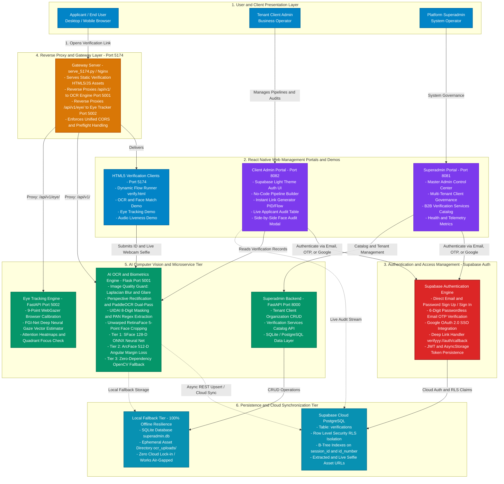
</details>

---

### 2. End-to-End Verification Sequence

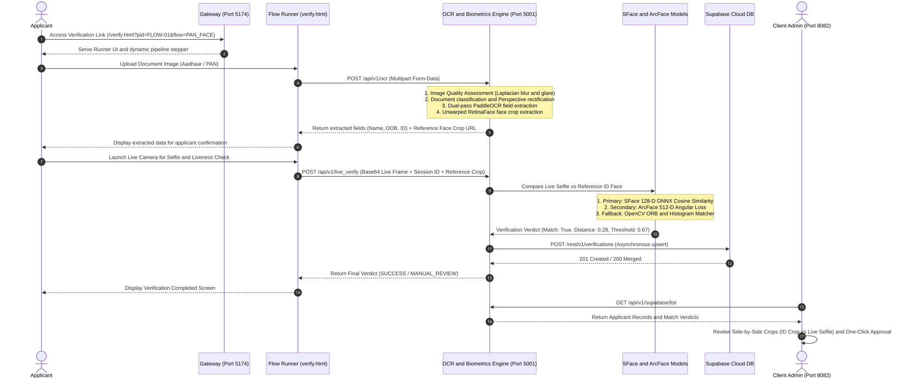

<details>
<summary>Click to view Mermaid Sequence Source</summary>

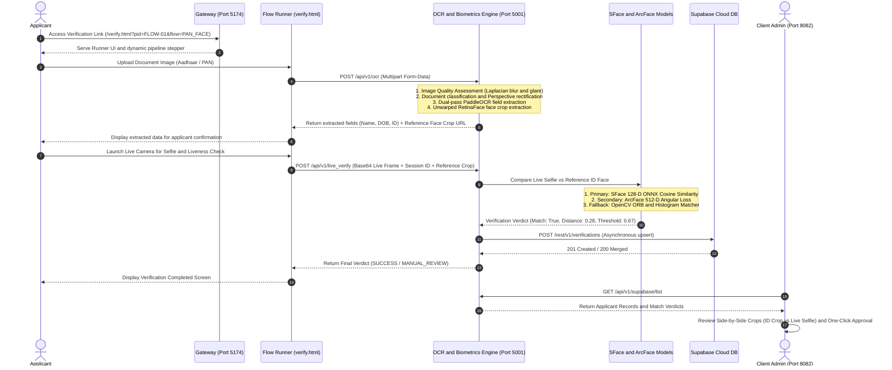
</details>

---

### 3. Dynamic Pipeline Builder & Runner Flow


<details>
<summary>Click to view Mermaid Flowchart Source</summary>

```mermaid
graph LR
    classDef builder fill:#4338ca,stroke:#3730a3,stroke-width:2px,color:#ffffff
    classDef link fill:#0284c7,stroke:#0369a1,stroke-width:2px,color:#ffffff
    classDef runner fill:#059669,stroke:#047857,stroke-width:2px,color:#ffffff
    classDef decision fill:#d97706,stroke:#b45309,stroke-width:2px,color:#ffffff

    subgraph BuilderStep ["1. Pipeline Construction (Admin Portal)"]
        Modules["Available Modules:<br/>- Aadhaar and Face<br/>- PAN and Face<br/>- Eye Tracking<br/>- Human Review"]:::builder
        Canvas["Visual Drag and Drop Canvas<br/>Order: Aadhaar -> Face Match -> Gaze"]:::builder
        Modules --> Canvas
    end

    subgraph LinkStep ["2. Parameterized Token Generation"]
        Generator["Generate Link Engine<br/>Creates Unique Pipeline ID PID"]:::link
        ShareURL["Shareable Applicant URL:<br/>/verify.html?pid=FLOW-9182&flow=AADHAAR_FACE,EYE_TRACKING"]:::link
        Canvas --> Generator --> ShareURL
    end

    subgraph ExecutionStep ["3. Dynamic Client Execution"]
        Parser["Flow Runner URL Parser<br/>Extracts active sequence"]:::runner
        Stepper["Dynamic Stepper Builder<br/>Renders Step 1..N with live indicators"]:::runner
        ShareURL --> Parser --> Stepper
    end

    subgraph VerdictStep ["4. Consolidated Verdict"]
        Audit["Unified Verification Record<br/>Status: PASSED / FLAGGED_FOR_AUDIT"]:::decision
        Stepper --> Audit
    end
```
</details>

---

### 4. Multi-Tier AI Face Match & Fallback Decision Logic


<details>
<summary>Click to view Mermaid Decision Tree Source</summary>

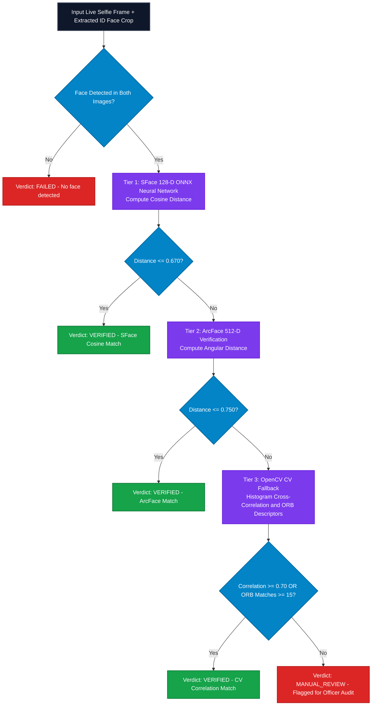
</details>

---

### 5. Multi-Modal Liveness & Anti-Spoofing Architecture


<details>
<summary>Click to view Mermaid Liveness Architecture Source</summary>

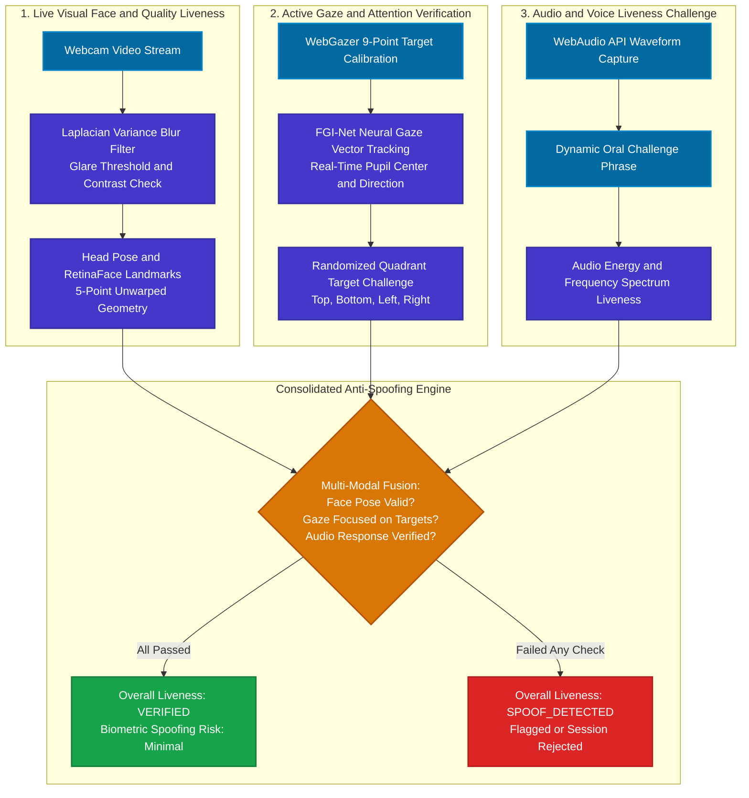
</details>

---

### 6. Supabase Entity-Relationship & Cloud Sync Architecture


<details>
<summary>Click to view Mermaid ER Diagram Source</summary>

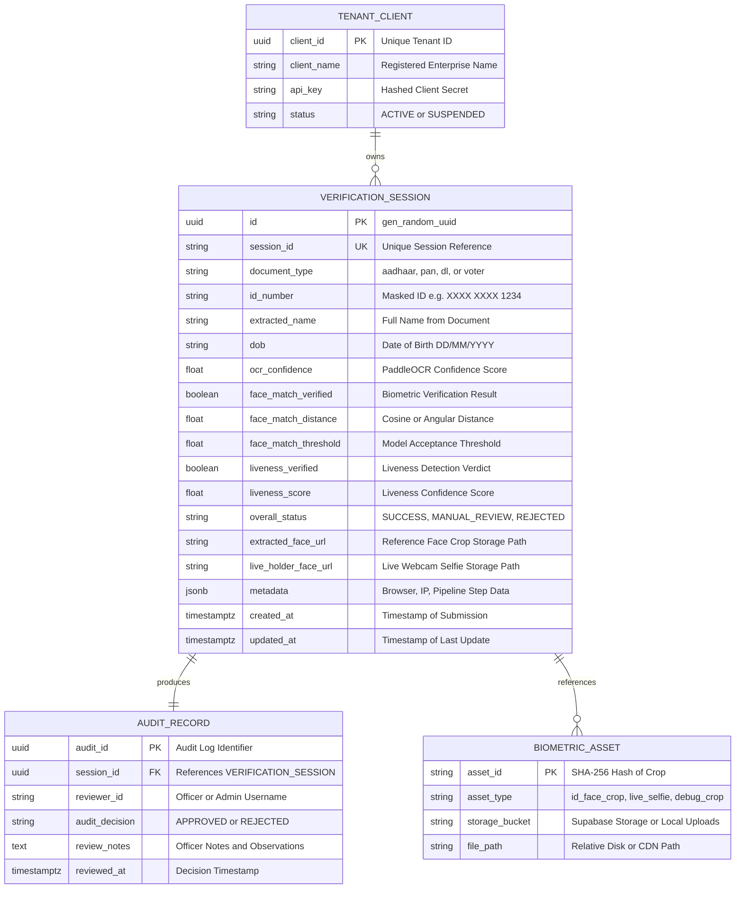
</details>

---

## Repository Structure

```
identity-verify-mvp/
├── .env.example                     # Environment template for Supabase cloud credentials
├── .gitignore                       # Clean Git configuration excluding models, uploads, logs
├── docker-compose.yml               # Multi-container orchestration (OCR, Eye Tracker, Nginx)
├── start_all.bat                    # One-click Windows launcher for all 4 services
├── start_all.sh                     # One-click Linux/macOS launcher for all 4 services
├── README.md                        # Comprehensive system documentation & architecture
├── supabase_schema.sql              # Supabase table DDL, RLS policies, and index statements
│
├── admin/                           # Client Admin Portal
│   └── frontend/                    # React Native Web application (Port 8082)
│       ├── App.js                   # Pipeline Builder, Links Manager, Live Review Queue
│       ├── SignInScreen.js          # Light theme auth screen (Email/Pass, OTP, Google SSO)
│       ├── app.json                 # Deep linking scheme configuration (verifyyy)
│       ├── lib/supabase.js          # Supabase client with web/mobile URL session detection
│       ├── src/services/
│       │   ├── auth.js              # Modular email password & 6-digit OTP service
│       │   └── googleAuth.js        # Google OAuth flow with deep linking & PKCE
│       ├── index.js                 # Application entrypoint
│       └── package.json             # React Native Web / Expo dependencies
│
├── products/                        # Verification Engines & Frontend Runners
│   ├── demo_ocr_face.html           # Standalone Document OCR & Live Face Match Demo
│   ├── demo_ocr_face.js             # Client logic for demo OCR and Supabase lookup
│   ├── demo_eye_tracking.html       # WebGazer eye tracking & attention calibration demo
│   ├── demo_eye_tracking.js         # Gaze tracking controller
│   ├── demo_audio_liveness.html     # Voice liveness & challenge-response demo
│   ├── demo_audio_liveness.js       # Audio waveform & speech verification logic
│   ├── verify.html                  # Dynamic Verifyyy Flow Runner UI
│   ├── verify.js                    # Multi-step pipeline execution engine
│   ├── webgazer.js                  # Precompiled WebGazer browser gaze tracking library
│   ├── style.css                    # Unified design system styles (Teal / Slate theme)
│   ├── nginx.conf                   # Reverse proxy configuration
│   ├── serve_5174.py                # Standalone Python Gateway & Reverse Proxy (Port 5174)
│   │
│   ├── ocr_engine/                  # Flask AI Computer Vision Engine (Port 5001)
│   │   ├── engine.py                # Core OCR, SFace, ArcFace, and verification APIs
│   │   ├── download_sface.py        # Automated SFace ONNX model downloader
│   │   ├── sface.onnx               # OpenCV SFace 128-D ONNX model binary
│   │   ├── supabase_client.py       # Resilient Supabase REST client (GET, LIST, UPSERT)
│   │   ├── quality.py               # Blur, glare, illumination, and sharpness checker
│   │   ├── FSRCNN_x2.pb             # Super-resolution model for low-res document crops
│   │   ├── Dockerfile               # Container build for OCR microservice
│   │   └── requirements.txt         # Python dependencies
│   │
│   ├── eye_tracking_module/         # FastAPI Eye Tracking Service (Port 5002)
│   │   ├── main.py                  # Gaze vector analytics API
│   │   ├── demo.py                  # Standalone OpenCV webcam tracker demo
│   │   ├── FGI-Net/                 # Deep neural gaze tracking research model
│   │   ├── fgi_eye_tracker/         # Real-time pupil & eye estimation library
│   │   ├── weights/                 # Trained model weights (fgi_net.pth)
│   │   ├── Dockerfile               # Container build for eye tracking
│   │   └── requirements.txt         # FastAPI dependencies
│   │
│   └── ocr_uploads/                 # Ephemeral runtime upload cache (.gitkeep protected)
│
└── superadmin/                      # Platform Superadmin Management System
    ├── backend/                     # FastAPI core backend (Port 8000)
    │   ├── main.py                  # Multi-tenant API endpoints & B2B service catalog
    │   ├── database.py              # SQLite / PostgreSQL SQLAlchemy connection
    │   ├── superadmin.db            # Local SQLite database
    │   ├── routers/dashboard.py     # Administrative analytics router
    │   └── requirements.txt         # FastAPI dependencies
    └── frontend/                    # React Native Web Superadmin Dashboard (Port 8081)
        ├── App.js                   # Tenant management & service overview UI
        ├── SignInScreen.js          # Master control login (Email/Pass, OTP, Google SSO)
        ├── app.json                 # Deep linking scheme configuration (verifyyy)
        ├── lib/supabase.js          # Supabase client with web/mobile URL session detection
        ├── src/services/
        │   ├── auth.js              # Modular email password & 6-digit OTP service
        │   └── googleAuth.js        # Google OAuth flow with deep linking & PKCE
        └── package.json             # Expo dependencies
```

---

## Microservices & Subsystems

### 1. Products Gateway Server
- **Implementation**: `products/serve_5174.py` (Local Python) or `products/nginx.conf` (Dockerized Nginx).
- **Port**: `5174`.
- **Purpose**: Serves static HTML5/JS verification clients and transparently proxies API requests (`/api/v1/*` to OCR Engine on port 5001, `/api/v1/eye/*` to Eye Tracker on port 5002) with full CORS support.

### 2. AI OCR & Face Verification Engine
- **Implementation**: `products/ocr_engine/engine.py`.
- **Framework**: Flask on port `5001`.
- **Capabilities**:
  - Image quality assessment (`quality.py`) for blur, glare, and low illumination.
  - Quadrilateral document edge detection and perspective transformation.
  - Dual-pass PaddleOCR with regex extraction for Aadhaar and PAN cards.
  - RetinaFace landmark extraction directly from unwarped raw frames.
  - SFace ONNX 128-D cosine distance matching (`sface.onnx`).
  - ArcFace 512-D angular margin verification with relaxed threshold (0.75).
  - Multi-feature OpenCV fallback (histogram correlation + ORB descriptors).
  - Asynchronous background synchronization to Supabase PostgreSQL.

### 3. Interactive Verification Flow Runner
- **Files**: `products/verify.html` and `products/verify.js`.
- **Port**: `http://localhost:5174/verify.html`.
- **Purpose**: Dynamically renders applicant verification steps according to the `flow` query parameter (e.g., `AADHAAR_FACE,EYE_TRACKING,HUMAN_REVIEW`).
- **Features**: Live camera preview, real-time facial framing indicators, instant OCR field confirmation, eye gaze calibration, and automated completion screens.

### 4. Client Admin Portal & Pipeline Builder
- **Files**: `admin/frontend/App.js`.
- **Framework**: React Native Web / Expo on port `8082`.
- **Features**:
  - **Visual Pipeline Builder**: Build, customize, and save multi-step verification recipes.
  - **Instant Link Generator**: Create shareable applicant links with customized parameters.
  - **Real-Time Audit Queue**: Review recent applicant submissions synced directly from Supabase.
  - **Side-by-Side Review Modal**: Inspect extracted ID photos against live webcam selfies with one-click Approve/Reject actions.

### 5. Superadmin Management Platform
- **Backend**: `superadmin/backend/main.py` (FastAPI on port `8000`).
- **Frontend**: `superadmin/frontend/App.js` (React Native Web on port `8081`).
- **Features**: Multi-tenant client onboarding, B2B service catalog management, API usage monitoring, and platform licensing.

### 6. Eye Tracking & Attention Analysis Module
- **Backend**: `products/eye_tracking_module/main.py` (FastAPI on port `5002`).
- **Client**: `products/webgazer.js` + `products/demo_eye_tracking.html`.
- **Features**: 9-point eye calibration grid, real-time attention heatmaps, and deep FGI-Net gaze vector tracking.

### 7. Voice & Audio Liveness Challenge
- **Files**: `products/demo_audio_liveness.html` and `products/demo_audio_liveness.js`.
- **Features**: In-browser audio waveform capture and speech challenge-response verification.

---

## Database & Cloud Sync (Supabase)

Verifyyy integrates natively with [Supabase](https://supabase.com) PostgreSQL database storage while remaining completely resilient to offline environments.

### 1. Database Schema DDL
Execute the schema script in your Supabase SQL Editor (`supabase_schema.sql`):

```sql
CREATE TABLE IF NOT EXISTS public.verifications (
    id UUID PRIMARY KEY DEFAULT gen_random_uuid(),
    session_id VARCHAR(255) UNIQUE NOT NULL,
    document_type VARCHAR(50),
    id_number VARCHAR(100),
    extracted_name VARCHAR(255),
    dob VARCHAR(50),
    ocr_confidence FLOAT DEFAULT 0.0,
    face_match_verified BOOLEAN DEFAULT FALSE,
    face_match_distance FLOAT,
    face_match_threshold FLOAT,
    liveness_verified BOOLEAN DEFAULT FALSE,
    liveness_score FLOAT DEFAULT 0.0,
    overall_status VARCHAR(50) DEFAULT 'PENDING',
    extracted_face_url TEXT,
    live_holder_face_url TEXT,
    metadata JSONB DEFAULT '{}'::jsonb,
    created_at TIMESTAMPTZ DEFAULT NOW(),
    updated_at TIMESTAMPTZ DEFAULT NOW()
);

ALTER TABLE public.verifications ENABLE ROW LEVEL SECURITY;

CREATE POLICY "Allow public read access" ON public.verifications FOR SELECT USING (true);
CREATE POLICY "Allow public insert access" ON public.verifications FOR INSERT WITH CHECK (true);
CREATE POLICY "Allow public update access" ON public.verifications FOR UPDATE USING (true);

CREATE INDEX IF NOT EXISTS idx_verifications_session_id ON public.verifications(session_id);
CREATE INDEX IF NOT EXISTS idx_verifications_id_number ON public.verifications(id_number);
```

### 2. Environment Configuration
Copy `.env.example` to `.env` in the repository root:

```bash
cp .env.example .env
```

Set your Supabase credentials:
```ini
SUPABASE_URL=https://your-project-ref.supabase.co
SUPABASE_KEY=your-supabase-anon-or-service-key
SUPABASE_TABLE=verifications
```

> **Zero-Downtime Fallback Guarantee**: If `.env` is omitted or credentials remain as placeholders, the platform automatically switches to **Local Standalone Mode** with SQLite persistence and local asset storage.

---

## Quick Start & Execution Guide

Verifyyy provides two distinct, fully supported deployment options:
- **Option A: Local Bare-Metal (Without Docker)** — Recommended for active frontend and backend development with hot-reloading.
- **Option B: Containerized Deployment (With Docker)** — Recommended for containerized staging, CI/CD, or deployment on servers.

---

### Prerequisites & Environment Setup

#### 1. System Requirements
Verify your installed runtimes before proceeding:
```bash
python --version   # Must be Python 3.10 or higher
node -v            # Must be Node.js 18.x or higher
npm -v             # Must be npm 9.x or higher
git --version
```
*(If using Docker, ensure **Docker Desktop** or **Docker Engine + Docker Compose v2** is running)*.

#### 2. Configure Environment Variables
Copy `.env.example` to `.env` in the repository root:

```bash
# Windows (CMD):
copy .env.example .env

# Windows (PowerShell):
Copy-Item .env.example .env

# Linux / macOS (Bash):
cp .env.example .env
```

Your `.env` file should contain:
```ini
# Supabase Cloud Configuration
EXPO_PUBLIC_SUPABASE_URL=https://mhxhttawwpqywedzpybf.supabase.co
EXPO_PUBLIC_SUPABASE_PUBLISHABLE_KEY=sb_publishable_fa7-pjSYD5TS9Z-YxOUMGQ_JrX2jY-E

SUPABASE_URL=https://mhxhttawwpqywedzpybf.supabase.co
SUPABASE_KEY=sb_publishable_fa7-pjSYD5TS9Z-YxOUMGQ_JrX2jY-E
SUPABASE_TABLE=verifications
```

---

### Option A: Complete Setup WITHOUT Docker (Local Bare-Metal)

You can launch all services automatically with a single script or start each service manually in its own dedicated terminal.

#### Method 1: One-Click Automated Launch

- **Windows**:
  Double-click `start_all.bat` or run from PowerShell / Command Prompt:
  ```cmd
  start_all.bat
  ```
  *(This automatically spawns separate console windows for OCR Engine 5001, Gateway 5174, Client Admin 8082, and Superadmin 8081)*.

- **Linux / macOS**:
  Make executable and run:
  ```bash
  chmod +x start_all.sh
  ./start_all.sh
  ```

---

#### Method 2: Step-by-Step Manual Multi-Terminal Startup

Open **4 separate terminal windows** from the `identity-verify-mvp` root directory:

#### 🖥️ Terminal 1: AI OCR & Biometrics Engine (Port 5001)
The core computer vision service for PaddleOCR, unwarped face crop extraction, SFace 128-D matching, and ArcFace verification.

```bash
cd products/ocr_engine

# 1. Create and activate a Python virtual environment
# On Windows (PowerShell / CMD):
python -m venv .venv
.venv\Scripts\activate

# On Linux / macOS (Bash):
# python3 -m venv .venv
# source .venv/bin/activate

# 2. Install Python dependencies
pip install -r requirements.txt

# 3. Ensure the SFace ONNX deep neural model is downloaded (if not present)
python download_sface.py

# 4. Start the Flask AI server
python engine.py
```
> **Output Confirmation**:  
> `* Running on http://127.0.0.1:5001`  
> Test in browser or curl: `http://localhost:5001/api/v1/supabase/list`

---

#### 🌐 Terminal 2: Products Gateway Server & Verification Runner (Port 5174)
Serves static HTML5 applicant verification pages (`verify.html`, demos) and transparently reverse-proxies `/api/v1/*` requests to port 5001 with unified CORS headers.

```bash
# From project root:
python products/serve_5174.py
```
> **Output Confirmation**:  
> `Starting Gateway on http://localhost:5174 ...`  
> Open in browser: `http://localhost:5174/verify.html`

---

#### 🏢 Terminal 3: Client Admin Portal (Port 8082)
The React Native Web / Expo portal for tenant administrators. Features Supabase Auth (Email, OTP, Google SSO), the visual drag-and-drop pipeline builder, instant link generator, and real-time audit queue.

```bash
cd admin/frontend

# 1. Install Node dependencies (first time only)
npm install

# 2. Start the Expo web application on port 8082
npx expo start --web --port 8082
```
> **Output Confirmation**:  
> `Web Bundled index.js (262 modules)`  
> Open in browser: `http://localhost:8082`

---

#### 👑 Terminal 4: Superadmin Management Portal & Backend (Ports 8081 & 8000)
The master governance portal for multi-tenant oversight and the B2B verification catalog.

**Sub-Terminal 4A: Superadmin Frontend (Port 8081)**:
```bash
cd superadmin/frontend
npm install
npx expo start --web --port 8081
```
> Open in browser: `http://localhost:8081`

**Sub-Terminal 4B (Optional): Superadmin Backend API (Port 8000)**:
```bash
cd superadmin/backend
pip install -r requirements.txt
uvicorn main:app --reload --port 8000
```
> Open Swagger Docs in browser: `http://localhost:8000/docs`

---

#### 👁️ Terminal 5 (Optional): Eye Tracking & Gaze Service (Port 5002)
Runs the deep FGI-Net gaze estimation and vector tracking service.

```bash
cd products/eye_tracking_module
pip install -r requirements.txt
uvicorn main:app --reload --port 5002
```
> Open in browser: `http://localhost:5002`

---

### Option B: Complete Setup WITH Docker (Docker Compose)

Docker Compose containerizes the core AI processing engines, the Nginx reverse proxy gateway, and volume caches.

#### 1. Architecture in Docker
- `ocr_module` (Flask + OpenCV + PaddleOCR + SFace ONNX on port `5001`)
- `accessibility_module` (Nginx reverse proxy on port `5174` serving verification HTML5 clients and routing `/api/v1/`)
- `eye_tracking_module` (FastAPI + FGI-Net gaze tracking on port `5002`)

#### 2. GPU vs CPU Mode Configuration
Inspect `docker-compose.yml`. By default, `ocr_module` reserves an NVIDIA GPU:
```yaml
deploy:
  resources:
    reservations:
      devices:
        - driver: nvidia
          count: all
          capabilities: [gpu]
```
> **If running on CPU only (no NVIDIA GPU)**: Simply comment out lines 15-21 in `docker-compose.yml` before building. The engine will automatically run in high-performance CPU inference mode.

#### 3. Build & Run Containers
Run from the repository root:

```bash
# Build images and run all services in detached (background) mode:
docker compose up --build -d
```

#### 4. Monitor & Inspect Containers
```bash
# Check container status:
docker compose ps

# View live combined logs:
docker compose logs -f

# View live logs for OCR Engine specifically:
docker compose logs -f ocr_module

# View live logs for Nginx Gateway:
docker compose logs -f accessibility_module
```

#### 5. Launch Frontends Alongside Docker
The React Native Web Expo portals run natively on your workstation with instant hot-reloading and communicate directly with the Dockerized backend containers:

- **Client Admin (Port 8082)**:
  ```bash
  cd admin/frontend
  npm install
  npx expo start --web --port 8082
  ```
- **Superadmin (Port 8081)**:
  ```bash
  cd superadmin/frontend
  npm install
  npx expo start --web --port 8081
  ```

#### 6. Stop Containers
```bash
# Stop and remove containers:
docker compose down

# Stop and remove containers along with volumes:
docker compose down -v
```

---

### Health Check & Service Verification

After launching either with or without Docker, test that all endpoints respond properly:

| Service | Target URL | Expected Response |
| :--- | :--- | :--- |
| **Client Admin Portal** | [http://localhost:8082](http://localhost:8082) | Renders clean Light Theme Supabase Login |
| **Superadmin Portal** | [http://localhost:8081](http://localhost:8081) | Renders Superadmin Login & Dashboard |
| **Gateway & Flow Runner** | [http://localhost:5174/verify.html](http://localhost:5174/verify.html) | Interactive Camera & Verification Stepper |
| **AI OCR & Face Engine** | [http://localhost:5001/api/v1/supabase/list](http://localhost:5001/api/v1/supabase/list) | `{"status":"success","data":[...]}` |
| **Superadmin Backend API** | [http://localhost:8000/api/v1/b2b/dashboard](http://localhost:8000/api/v1/b2b/dashboard) | `{"status":"success","data":{...}}` |


---

## Port & Service Routing Matrix

| Service | Port / URL | Tech Stack | Description |
| :--- | :--- | :--- | :--- |
| **Central Gateway** | [http://localhost:5174](http://localhost:5174) | Python / Nginx | Gateway reverse proxy and static demo server |
| **Verifyyy Dynamic Flow Runner** | [http://localhost:5174/verify.html](http://localhost:5174/verify.html) | HTML5 / JavaScript | Interactive applicant verification pipeline |
| **OCR & Face Match Demo** | [http://localhost:5174/demo_ocr_face.html](http://localhost:5174/demo_ocr_face.html) | HTML5 / JavaScript | Standalone document OCR & webcam matching UI |
| **Eye Tracking Demo** | [http://localhost:5174/demo_eye_tracking.html](http://localhost:5174/demo_eye_tracking.html) | WebGazer / JS | Browser-based eye gaze calibration demo |
| **Audio Liveness Demo** | [http://localhost:5174/demo_audio_liveness.html](http://localhost:5174/demo_audio_liveness.html) | HTML5 WebAudio | Voice challenge & liveness demo |
| **OCR & Face Engine** | [http://localhost:5001](http://localhost:5001) | Flask / OpenCV / ONNX | Core computer vision and biometrics service |
| **Eye Tracking Engine** | [http://localhost:5002](http://localhost:5002) | FastAPI / FGI-Net | Deep gaze analytics and vector estimation |
| **Client Admin Portal** | [http://localhost:8082](http://localhost:8082) | React Native Web / Expo | Pipeline builder, link manager, and audit queue |
| **Superadmin Frontend** | [http://localhost:8081](http://localhost:8081) | React Native Web / Expo | Multi-tenant platform governance dashboard |
| **Superadmin Backend API** | [http://localhost:8000](http://localhost:8000) | FastAPI / SQLAlchemy | B2B service catalog and client account API |

---

## Comprehensive API Reference

### 1. Document OCR & Face Extraction
```http
POST /api/v1/ocr
Content-Type: multipart/form-data
```

**Request Parameters**:
- `image`: Binary file (JPEG / PNG).
- `doc_type`: (Optional) `aadhaar` | `pan` | `auto`.

**Sample Response (200 OK)**:
```json
{
  "status": "success",
  "session_id": "a8f3b92c",
  "document_type": "aadhaar",
  "extracted_fields": {
    "name": "Jane Doe",
    "dob": "15/08/1995",
    "aadhaar_number": "XXXX XXXX 1234"
  },
  "ocr_confidence": 94.8,
  "face_image_url": "/ocr_uploads/id_face_a8f3b92c.jpg",
  "supabase_sync": {
    "synced": true,
    "status": "success"
  }
}
```

---

### 2. Live Face Verification & Liveness
```http
POST /api/v1/live_verify
Content-Type: application/json
```

**Request Payload**:
```json
{
  "image": "data:image/jpeg;base64,...",
  "session_id": "a8f3b92c",
  "step3_faces": ["id_face_a8f3b92c.jpg"]
}
```

**Sample Response (200 OK)**:
```json
{
  "status": "success",
  "session_id": "a8f3b92c",
  "step41_complete": true,
  "face_match": true,
  "step3_face_matches": [
    {
      "step3_face": "id_face_a8f3b92c.jpg",
      "verified": true,
      "distance": 0.284,
      "threshold": 0.670,
      "model": "SFace_Deep_Neural_Network"
    }
  ],
  "overall_status": "SUCCESS",
  "supabase_sync": {
    "synced": true,
    "status": "success"
  }
}
```

---

### 3. Fetch Verification Record
```http
GET /api/v1/supabase/get/{session_id_or_id_number}
```

**Response**: Returns the matched verification session row from Supabase Cloud or local store.

---

### 4. List Verification Sessions
```http
GET /api/v1/supabase/list
```

**Response**: Returns the 50 most recent applicant verification records for the Client Admin review table.

---

### 5. Superadmin B2B Services Catalog
```http
GET /api/v1/b2b/verification-services
```

**Response**: Returns available verification modules (Aadhaar & Face, PAN & Face, Eye Tracking, etc.).

---

## Security, Privacy & UIDAI Compliance

- **UIDAI Data Masking**: Aadhaar card numbers are masked by default (first 8 digits masked: `XXXX XXXX 1234`) in compliant views.
- **Strict PII Sanitization in Git**: The root `.gitignore` strictly excludes all uploaded applicant identity documents, live selfies, face crops, and temporary logs from version control.
- **Isolated Secret Management**: Cloud credentials (`.env`) are never committed to the repository; `.env.example` provides safe placeholder schemas.
- **Row Level Security (RLS)**: Enforces database boundaries so tenant clients access only their respective verification sessions.
- **Ephemeral Processing**: Biometric embeddings are computed in memory during the verification request lifecycle without storing raw biometric vectors permanently.

---

## License

This project is licensed under the [MIT License](LICENSE).
